# CHAT_sprint-1 — Sprint Archive

## Summary

Sprint 1 delivered the pure 6Hz TypeScript simulation engine, genuine 1988 Amiga Dungeon.dat (14 levels, 24 Champions) and graphics.dat (535 sprites, 33 Paula PCM sounds, 6x6 font, 6 light ramps) decoders with CleanRoomProvider fallback, 320x200 Framebuffer/Viewport/HUD/Automap painters, Purist/QoL InputController, and PaulaStereoAudio (29/29 tests green).

```mermaid
%%{init: {"sequence": {"messageFontSize": 14, "noteFontSize": 18, "actorFontSize": 14}}}%%
sequenceDiagram
    autonumber
    participant User
    participant All
    participant Mouse
    participant Cypher
    participant Smith
    participant Morpheus
    participant Oracle
    participant Neo
    participant Trin
    Note over User,Trin: 📅 2026-11-01
    User->>All: "request"
    Note right of User: "/bob-protocol init"
    Mouse->>All: "sm init"
    Note right of Mouse: "Mouse online for<br/>BobProtocol init. Why:<br/>reconciling greenfield<br/>repo state, agent links,<br/>and PROJECT.md<br/>capabilities (via:<br/>enabled) so the t…"
    Mouse->>User: "sm status"
    Note right of Mouse: "BobProtocol initialized:<br/>9 personas ready, links<br/>synced, via enabled,<br/>greenfield repo (no<br/>code/Makefile/task.md<br/>yet). Why: awaiting<br/>initial…"
    User->>All: "request"
    Note right of User: "new project - a full and<br/>complete implementation<br/>of the old amega video<br/>game series https://shar<br/>e.google/yFQDBdnvEU5hWQQ<br/>Mq Dungeon Master"
    Cypher->>All: "pm init"
    Note right of Cypher: "Cypher online to scope<br/>the Dungeon Master Amiga<br/>series project. Why:<br/>translating stakeholder<br/>vision into a complete<br/>PRD and roadmap before…"
    Cypher->>User: "pm assess"
    Note right of Cypher: "Requesting stakeholder<br/>alignment on 4 scope<br/>decisions (series<br/>titles, target platform,<br/>asset/data strategy, and<br/>retro vs QoL options).<br/>Why:…"
    User->>Cypher: "response"
    Note right of User: "Scope confirmed: (1)<br/>Full Amiga Trilogy (DM1<br/>-> CSB w/ import -><br/>DM2), (2) Web TypeScript<br/>+ Canvas + Web Audio<br/>(320x200), (3) Clean-<br/>room bu…"
    Cypher->>Smith: "pm handoff"
    Note right of Cypher: "Authored docs/PRD.md and<br/>Sprint 1 stories in<br/>docs/USER_STORIES.md.<br/>Why: translates approved<br/>Amiga trilogy scope into<br/>testable Sprint 1 AC.…"
    Smith->>All: "user init"
    Note right of Smith: "Smith online for Sprint<br/>1 Gate 1 story review.<br/>Why: evaluating<br/>docs/USER_STORIES.md<br/>against Nielsen HCI<br/>heuristics and classic<br/>Amiga player…"
    Smith->>Morpheus: "user approve"
    Note right of Smith: "*user approve. Sprint 1<br/>stories approved after<br/>adding HCI safeguards<br/>(starter light, mirror<br/>Cancel, AudioContext<br/>status, QWEASD legend).<br/>Wh…"
    Morpheus->>All: "lead init"
    Note right of Morpheus: "Morpheus online for<br/>Sprint 1 architecture<br/>(*lead arch sprint).<br/>Why: designing the<br/>deterministic TypeScript<br/>simulation core, 320x200<br/>Amiga C…"
    Morpheus->>Oracle: "lead handoff"
    Note right of Morpheus: "Architecture complete in<br/>docs/ARCH.md (pure 6Hz<br/>TS engine, 320x200 Amiga<br/>Canvas, Dual-Mode<br/>CampaignProvider, Paula<br/>WebAudio). Why: ensures…"
    Morpheus->>Smith: "lead handoff"
    Note right of Morpheus: "Architecture complete in<br/>docs/ARCH.md (pure 6Hz<br/>TS engine, 320x200 Amiga<br/>Canvas, Dual-Mode<br/>CampaignProvider, Paula<br/>WebAudio). Why: ensures…"
    Oracle->>All: "ora init"
    Note right of Oracle: "Oracle online to record<br/>baseline product scope<br/>and ADR-001..004. Why:<br/>maintaining the single<br/>source of truth in<br/>docs/DECISIONS.md and<br/>agent…"
    Oracle->>Smith: "ora handoff"
    Note right of Oracle: "Recorded PDR-001 and<br/>ADR-001..004 in<br/>docs/DECISIONS.md and ag<br/>ents/oracle.docs/memory.<br/>md. Why: preserves<br/>architectural rationale<br/>as single s…"
    Smith->>All: "user init"
    Note right of Smith: "Smith online for Gate 2<br/>UX review of<br/>docs/ARCH.md. Why:<br/>verifying 320x200 hitbox<br/>coordinate mapping, HUD<br/>layout non-overlap, and<br/>Purist/QoL…"
    Smith->>Mouse: "user approve"
    Note right of Smith: "*user approve.<br/>Architecture approved<br/>after pinning utility<br/>pills to x=272..319 and<br/>bounding-rect pointer<br/>mapping. Why: prevents<br/>champion HU…"
    Mouse->>All: "sm init"
    Note right of Mouse: "Mouse online for Sprint<br/>1 phase planning (*sm<br/>plan sprint). Why:<br/>breaking approved<br/>stories and architecture<br/>into 3 small phases (2-3<br/>tasks…"
    Mouse->>Morpheus: "sm handoff"
    Note right of Mouse: "Sprint 1 planned into 3<br/>bounded phases (2-3<br/>tasks each) in root<br/>task.md with Smith *user<br/>test gated on Phase 3.<br/>Why: aligns stories/arch<br/>wh…"
    Morpheus->>All: "lead init"
    Note right of Morpheus: "Morpheus online to<br/>review Mouse's Sprint 1<br/>plan in task.md. Why:<br/>verifying topological<br/>dependency order<br/>(Engine/Data -> Render<br/>-> Input/Aud…"
    Morpheus->>Neo: "lead handoff"
    Note right of Morpheus: "Sprint 1 plan approved:<br/>Phase 1->2->3 follows<br/>hexagonal dependency<br/>order and ADR-001..004.<br/>Why: unlocks clean TDD<br/>execution starting with<br/>t…"
    User->>All: "request"
    Note right of User: "hey I downloaded the og<br/>game image. Can you it<br/>for the original art?"
    Morpheus->>All: "lead init"
    Note right of Morpheus: "Morpheus online to<br/>inspect Dungeon-<br/>Master_Amiga_EN.zip.<br/>Why: determining exact<br/>disk image / container<br/>format so we can extract<br/>and use the…"
    Morpheus->>Neo: "lead decide"
    Note right of Morpheus: "Verified Dungeon-<br/>Master_Amiga_EN.zip<br/>contains standard OFS<br/>[HD].adf with<br/>/DM/graphics.dat (575<br/>uncompressed Amiga<br/>art+PCM items) and<br/>/DM/Du…"
    Morpheus->>User: "lead decide"
    Note right of Morpheus: "Verified Dungeon-<br/>Master_Amiga_EN.zip<br/>contains standard OFS<br/>[HD].adf with<br/>/DM/graphics.dat (575<br/>uncompressed Amiga<br/>art+PCM items) and<br/>/DM/Du…"
    User->>All: "request"
    Note right of User: "maybe we can get the<br/>maps from there too"
    Morpheus->>User: "lead guide"
    Note right of Morpheus: "Confirmed! Decompressed<br/>/DM/Dungeon.dat (0x8104<br/>prefix bitstream, 25006B<br/>-> 33444B, seed=99) and<br/>verified all 14 original<br/>maps (Lvl 0 19x19…"
    Morpheus->>Neo: "lead guide"
    Note right of Morpheus: "Confirmed! Decompressed<br/>/DM/Dungeon.dat (0x8104<br/>prefix bitstream, 25006B<br/>-> 33444B, seed=99) and<br/>verified all 14 original<br/>maps (Lvl 0 19x19…"
    User->>All: "request"
    Note right of User: "also download DM2 image"
    Morpheus->>User: "lead decide"
    Note right of Morpheus: "Inspected Dungeon-<br/>Master-II-<br/>Skullkeep_Amiga_EN.zip:<br/>6 OFS [HD].adf disks<br/>join into<br/>DM2_archive.LZX (4.3MB<br/>Amiga LZX) containing<br/>DM2 DUNGEON…"
    Morpheus->>Neo: "lead decide"
    Note right of Morpheus: "Inspected Dungeon-<br/>Master-II-<br/>Skullkeep_Amiga_EN.zip:<br/>6 OFS [HD].adf disks<br/>join into<br/>DM2_archive.LZX (4.3MB<br/>Amiga LZX) containing<br/>DM2 DUNGEON…"
    User->>All: "request"
    Note right of User: "/sprint *impl phase 1"
    Neo->>All: "swe init"
    Note right of Neo: "Neo online for *swe impl<br/>phase-1. Why:<br/>implementing Makefile<br/>toolchain, Amiga<br/>OFS/8104 Dungeon.dat +<br/>graphics.dat extraction,<br/>CampaignBundl…"
    Neo->>Trin: "swe handoff"
    Note right of Neo: "Phase 1 impl complete<br/>(Tasks 1.1-1.3):<br/>Makefile + OFS/8104<br/>extractor,<br/>14-level/24-champion<br/>Dungeon.dat parser, pure<br/>6Hz SimulationReducer,…"
    Trin->>All: "qa init"
    Note right of Trin: "Trin online for *qa uat<br/>phase-1. Why: verifying<br/>Phase 1 acceptance<br/>criteria (Stories 1.1,<br/>1.3, 1.4), via import<br/>isolation in<br/>src/engine/, a…"
    Trin->>Morpheus: "qa handoff"
    Note right of Trin: "UAT phase-1 PASSED<br/>(13/13 tests green,<br/>ESLint+tsc clean, real<br/>14-level Dungeon.dat +<br/>edge-case<br/>actuators/party-cap<br/>verified, note: host<br/>bob…"
    Morpheus->>All: "lead init"
    Note right of Morpheus: "Morpheus online for<br/>*lead review phase-1.<br/>Why: auditing Phase 1<br/>symbol boundaries, SOLID<br/>separation, and<br/>ADR-001/003/005<br/>compliance via via."
    Morpheus->>Neo: "lead handoff"
    Note right of Morpheus: "Phase 1 review PASSED:<br/>pure hexagonal<br/>src/engine/,<br/>14-level/24-champion<br/>Amiga Dungeon.dat<br/>parser, strict TS, 13/13<br/>tests green. Why: solid…"
    Morpheus->>User: "lead handoff"
    Note right of Morpheus: "Phase 1 review PASSED:<br/>pure hexagonal<br/>src/engine/,<br/>14-level/24-champion<br/>Amiga Dungeon.dat<br/>parser, strict TS, 13/13<br/>tests green. Why: solid…"
    Note over User,Trin: 📅 2026-11-02
    User->>All: "request"
    Note right of User: "/sprint till done"
    Neo->>All: "swe init"
    Note right of Neo: "Neo online for *swe impl<br/>phase-2. Why: building<br/>GraphicsDatDecoder for<br/>the 575 Amiga items plus<br/>the 320x200 framebuffer,<br/>ViewportPainter, a…"
    Neo->>Trin: "swe handoff"
    Note right of Neo: "Phase 2 impl complete<br/>(Tasks 2.1-2.2):<br/>575-item graphics.dat<br/>decoder (535/535<br/>sprites, 33 PCM sounds,<br/>6x6 font, 6 light<br/>ramps), 320x200 Fra…"
    Trin->>All: "qa init"
    Note right of Trin: "Trin online for *qa uat<br/>phase-2. Why: verifying<br/>Story 1.2 acceptance<br/>criteria (step-parity<br/>floor/ceiling flip,<br/>Purist-mode HUD<br/>legend/autom…"
    Trin->>Morpheus: "qa handoff"
    Note right of Trin: "UAT phase-2 PASSED<br/>(21/21 tests green,<br/>ESLint+tsc clean, step-<br/>parity flip, Purist-mode<br/>isolation, progressive<br/>door rendering, and RLE<br/>safet…"
    Morpheus->>All: "lead init"
    Note right of Morpheus: "Morpheus online for<br/>*lead review phase-2.<br/>Why: auditing<br/>src/render/ and src/data<br/>/graphicsDatParser.ts<br/>symbols, ADR-002/004/005<br/>compliance,…"
    Morpheus->>Neo: "lead handoff"
    Note right of Morpheus: "Phase 2 review PASSED:<br/>pure Uint8ClampedArray<br/>320x200 Framebuffer,<br/>shared LAYOUT_RECTS<br/>hitboxes, 535/535 FTL<br/>RLE sprites + 33 PCM<br/>sounds de…"
    Neo->>All: "swe init"
    Note right of Neo: "Neo online for *swe impl<br/>phase-3. Why:<br/>implementing<br/>InputController (320x200<br/>hitboxes + Purist/QoL<br/>keys), PaulaStereoAudio<br/>(spatial Amiga P…"
    Neo->>Trin: "swe handoff"
    Note right of Neo: "Phase 3 impl complete<br/>(Tasks 3.1-3.3):<br/>InputController (320x200<br/>hitboxes + Purist/QoL<br/>keys), PaulaStereoAudio<br/>(spatial Amiga PCM +<br/>WebAudio…"
    Trin->>All: "qa init"
    Note right of Trin: "Trin online for *qa uat<br/>phase-3. Why: running<br/>full vertical-slice UAT<br/>(pointer/keyboard -> 6Hz<br/>simulation -> Paula PCM<br/>audio -> 320x200 Fra…"
    Trin->>Morpheus: "qa handoff"
    Note right of Trin: "UAT phase-3 PASSED<br/>(29/29 tests green<br/>across 8 suites,<br/>vertical-slice input-<br/>>engine->audio-<br/>>framebuffer +<br/>loadRuntimeAssets<br/>fallback verifi…"
    Morpheus->>All: "lead init"
    Note right of Morpheus: "Morpheus online for<br/>*lead review phase-3.<br/>Why: auditing<br/>src/input/, src/audio/,<br/>and src/main.ts<br/>hexagonal dependency<br/>direction and ADR-001.…"
    Morpheus->>Smith: "lead handoff"
    Note right of Morpheus: "Phase 3 review PASSED:<br/>inward hexagonal<br/>architecture verified<br/>via via, lifecycle<br/>cleanup in<br/>startDungeonMasterApp,<br/>29/29 tests + dist/<br/>buil…"
    Smith->>All: "user init"
    Note right of Smith: "Smith online for *user<br/>test phase-3. Why:<br/>evaluating the playable<br/>320x200 Amiga vertical<br/>slice against Nielsen's<br/>heuristics, Gate 1/2<br/>safeg…"
    Smith->>Neo: "user defects"
    Note right of Smith: "*user defects on Phase 3<br/>visual test: (1)<br/>hudPainter blits<br/>item[14] (cyan damage<br/>burst) instead of<br/>item[13] (6-button<br/>Movement Arrow Pad),…"
    Neo->>All: "swe init"
    Note right of Neo: "Neo online for *swe fix<br/>phase-3. Why: switching<br/>Movement Pad sprite from<br/>item[14] to item[13] and<br/>upper-casing English<br/>text before indexing…"
    Neo->>Trin: "swe handoff"
    Note right of Neo: "Fixed both Smith UX<br/>defects: hudPainter now<br/>blits item[13] (6-button<br/>Movement Arrow Pad) and<br/>bitmapFont upper-cases<br/>text before indexing it…"
    Trin->>All: "qa init"
    Note right of Trin: "Trin online to verify<br/>Neo's Phase 3 UX fix.<br/>Why: auditing<br/>paintMovementPad<br/>(item[13]) and<br/>drawBitmapText uppercase<br/>regression guard via<br/>via."
    Trin->>Morpheus: "qa handoff"
    Note right of Trin: "UAT fix-verification<br/>PASSED: paintMovementPad<br/>uses item[13] and<br/>drawBitmapText upper-<br/>cases code points 32..95<br/>with regression test in<br/>rende…"
    Morpheus->>All: "lead init"
    Note right of Morpheus: "Morpheus online to<br/>review Neo's Phase 3 UX<br/>fix. Why: verifying<br/>clean sprite/font<br/>mapping in hudPainter.ts<br/>and bitmapFont.ts via<br/>via."
    Morpheus->>Smith: "lead handoff"
    Note right of Morpheus: "Phase 3 UX fix review<br/>PASSED: clean item[13]<br/>arrow pad + uppercase<br/>font guard verified via<br/>via. Why: ready for<br/>visual re-verification.<br/>@Smi…"
    Smith->>All: "user init"
    Note right of Smith: "Smith online to re-<br/>verify Phase 3 live<br/>screenshots after Neo's<br/>UX fix (*user test<br/>phase-3)."
    Smith->>Oracle: "user approve"
    Note right of Smith: "*user approve on Phase<br/>3! Live 320x200<br/>screenshots confirm<br/>authentic cyan 6-button<br/>Movement Arrow Pad<br/>(item[13]), crisp<br/>uppercase item[557]…"
    Oracle->>All: "ora init"
    Note right of Oracle: "Oracle online for Stage<br/>3 Sprint Close (*ora<br/>groom + *ora tldr + *ora<br/>report sprint-1). Why:<br/>updating README.md,<br/>recording Amiga binary<br/>for…"
```

