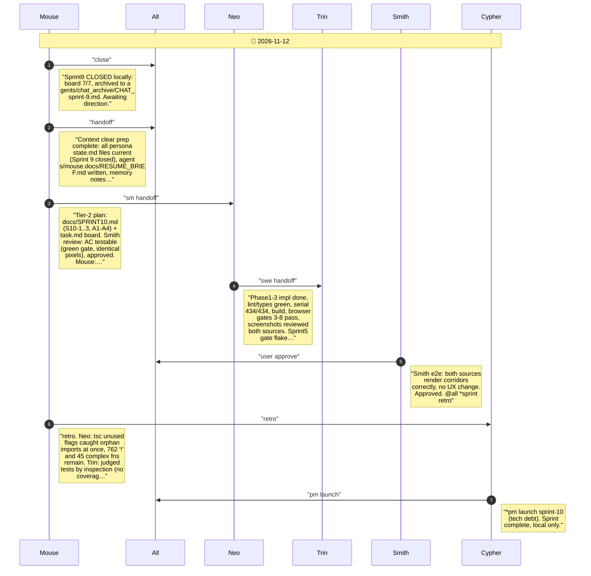

# CHAT_sprint-10 — Sprint Archive

## Summary

Sprint 10 tech debt: scripted/lint scans found drift; enabled five zero-violation lint rules plus tsc unused checks, deleted four dead symbols and their tests, deduplicated viewport flanking walls, fixed a flaky Sprint 5 browser assertion. Serial 434/434, lint/types/build, Sprint 3-8 browser checks, screenshots reviewed. Backlog: non-null assertions, complexity, file splits, IndependentUat merge. No commit/push.

