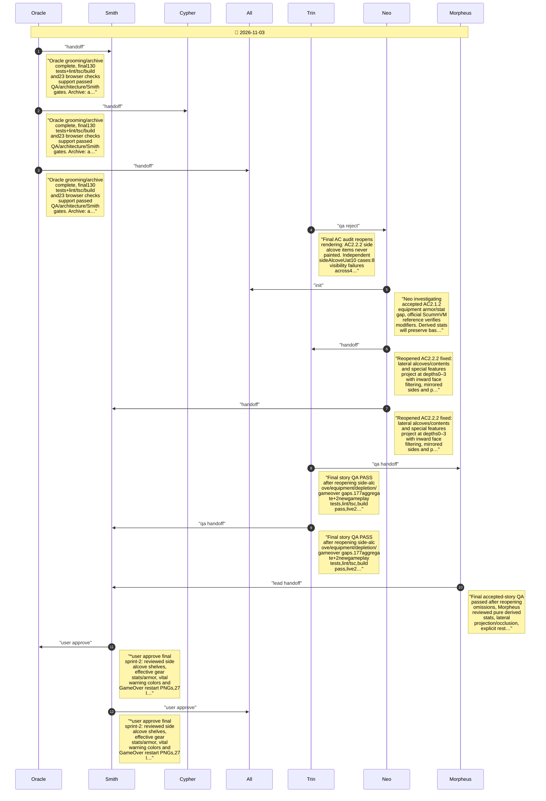

# CHAT_sprint-2-acceptance — Sprint Archive

## Summary

Final accepted-story audit reopened omitted side alcoves, equipment stat effects, vital warnings and GameOver/restart after initial phase approvals. All omissions fixed and independently reviewed. Final177 aggregate tests plus2 additional gameplay tests, lint/typecheck, build,27 actual Chromium checks and20 rendered scenes passed. Trace audit unavailable missingjinja2; no deployment. Final QA, architecture and Smith approvals supersede initial incomplete approvals.

