# CHAT_sprint-2-assets — Sprint Archive

## Summary

Asset-export sprint delivered local indexed PNGs plus deterministic manifest, strict original palette validation, safe owned-output reruns and independent native review. All AE1–8 passed QA, architecture, Tank and Smith gates. Fresh final evidence:31 affected tests, lint/types and535 native-decoded PNGs/1,690,768 pixels with unchanged source; earlier226 aggregate/build predate final isolated palette guard. Oracle grooming and seven domain retrospectives complete. Raw transparency and sparse classification limits documented. No commit/push/deploy.

```mermaid
%%{init: {"sequence": {"messageFontSize": 14, "noteFontSize": 18, "actorFontSize": 14}}}%%
sequenceDiagram
    autonumber
    participant Trin
    participant Cypher
    participant Neo
    participant Morpheus
    participant Oracle
    participant Mouse
    participant Smith
    participant All
    participant User
    participant Tank
    Note over Trin,Tank: 📅 2026-11-03
    Trin->>Cypher: "retro"
    Note right of Trin: "Retro: independent<br/>spatial/input/load tests<br/>and live PNGs caught<br/>real defects, final AC<br/>audit caught omitted<br/>features. Use AC<br/>coverage befo…"
    Neo->>Cypher: "retro"
    Note right of Neo: "Neo retro: shared<br/>geometry and listener<br/>cleanup helped, tests<br/>plus live review caught<br/>different defects. Why:<br/>preserve cursor-load and<br/>sile…"
    Morpheus->>Cypher: "retro"
    Note right of Morpheus: "Derived stats and<br/>semantic render adapters<br/>preserved engine<br/>boundaries, final story<br/>audit caught omissions<br/>phase reviews missed.<br/>Keep expli…"
    Oracle->>Cypher: "retro"
    Note right of Oracle: "Docs and phase status<br/>drifted from<br/>implementation, final<br/>audit corrected both<br/>instead of weakening<br/>requirements. Preserve<br/>primary numeric s…"
    Mouse->>Cypher: "retro"
    Note right of Mouse: "Short handoffs enabled<br/>independent fixes, but<br/>shared build logs<br/>require serial make<br/>calls. Track every<br/>accepted criterion in<br/>root task.md a…"
    Smith->>Cypher: "retro"
    Note right of Smith: "Live PNG/input review<br/>caught unreadable<br/>scrolls and validated<br/>final side shelves, gear<br/>feedback, warnings and<br/>restart. Keep browser<br/>fixture…"
    Cypher->>Cypher: "retro"
    Note right of Cypher: "Stories exposed<br/>omissions beyond phase<br/>shorthand, final audit<br/>completed equipment<br/>effects, side alcoves<br/>and death feedback. Keep<br/>criteria m…"
    Cypher->>All: "pm launch"
    Note right of Cypher: "*pm launch sprint-2.<br/>Final accepted stories<br/>delivered locally after<br/>QA/architecture/Smith<br/>approval and all-domain<br/>retro.177suite+2QA<br/>tests,…"
    Neo->>User: "swe fix"
    Note right of Neo: "Removed duplicate labels<br/>over original inventory<br/>button artwork, fallback<br/>panels retain labels<br/>because they lack<br/>authored glyphs. Four<br/>affe…"
    Neo->>User: "swe fix"
    Note right of Neo: "Fixed torch/cursor:<br/>centered complete<br/>sprite, hide duplicate<br/>arrow, no edge hotspot<br/>drift. Real torch art<br/>was<br/>reversed,4unlit..7full<br/>flame…"
    User->>All: "request"
    Note right of User: "Create Tank’s missing<br/>SDLC.md documenting<br/>actual project workflow."
    Tank->>All: "init"
    Note right of Tank: "Tank initialized to<br/>document existing<br/>lifecycle, automation<br/>and release boundaries<br/>so future work follows<br/>verified project<br/>practice."
    Tank->>User: "handoff"
    Note right of Tank: "SDLC workflow facts<br/>audited, but required<br/>SDLC template is absent<br/>from project/shared/BobP<br/>rotocol templates. @User<br/>provide template<br/>locatio…"
    Tank->>Morpheus: "handoff"
    Note right of Tank: "SDLC.md now follows<br/>recovered Darius base+JS<br/>templates and actual<br/>automation, all ten<br/>sections/links checked,<br/>gaps explicit. @Morpheus<br/>revi…"
    User->>All: "request"
    Note right of User: "$sprint next sprint —<br/>select next backlog<br/>scope and run the sprint<br/>workflow under<br/>docs/SDLC.md."
    Cypher->>All: "init"
    Note right of Cypher: "Cypher resumed next-<br/>sprint planning from<br/>ADR-009 and the prior<br/>exporter recommendation.<br/>Scope is a bounded local<br/>sprite-export tool so<br/>art…"
    Cypher->>Oracle: "pm ask"
    Note right of Cypher: "@Oracle *ora ask:<br/>confirm ADR-009 exporter<br/>order and output<br/>constraints, using<br/>recorded memory/lessons<br/>before combined product<br/>and architec…"
    Tank->>All: "init"
    Note right of Tank: "Tank resumed under<br/>docs/SDLC.md to review<br/>the planned sprite-<br/>export mechanism.<br/>Existing Node/Vite and<br/>ignored build output can<br/>support it w…"
    Cypher->>Morpheus: "pm handoff"
    Note right of Cypher: "Exporter stories and<br/>AE-1..8 evidence map<br/>drafted from ADR-009, no<br/>runtime migration or<br/>combat scope. @Morpheus<br/>*lead arch<br/>sprint-2-assets…"
    Morpheus->>All: "init"
    Note right of Morpheus: "Morpheus initialized<br/>combined Tier2 asset-<br/>export design from saved<br/>state and Oracle<br/>guidance, reuse parser<br/>and existing tools,<br/>preserve ind…"
    Morpheus->>Smith: "lead handoff"
    Note right of Morpheus: "Combined asset-export<br/>architecture ready,<br/>parser completeness,<br/>indexed pixels, safe<br/>local reruns and<br/>independent PNG decode<br/>are explicit. @…"
    Morpheus->>Tank: "lead handoff"
    Note right of Morpheus: "Combined asset-export<br/>architecture ready,<br/>parser completeness,<br/>indexed pixels, safe<br/>local reruns and<br/>independent PNG decode<br/>are explicit. @…"
    Tank->>Neo: "devops approve"
    Note right of Tank: "Tank approves export<br/>mechanism: existing<br/>Node/Vite, quoted<br/>input/output vars, owned<br/>ignored build output and<br/>prepublish validation,<br/>no new…"
    Tank->>Morpheus: "devops approve"
    Note right of Tank: "Tank approves export<br/>mechanism: existing<br/>Node/Vite, quoted<br/>input/output vars, owned<br/>ignored build output and<br/>prepublish validation,<br/>no new…"
    Smith->>All: "init"
    Note right of Smith: "Smith reviewing combined<br/>exporter stories/design:<br/>explicit input errors,<br/>deterministic manifest<br/>and honest raw-alpha<br/>policy make artifact b…"
    Smith->>Morpheus: "user approve"
    Note right of Smith: "*user approve stories<br/>sprint-2-assets. AE-1..8<br/>are concrete and<br/>testable, missing<br/>input/safe reruns and<br/>representative PNG<br/>inspection cover…"
    Smith->>Mouse: "user approve"
    Note right of Smith: "*user approve<br/>architecture<br/>sprint-2-assets. Raw<br/>index0 export policy is<br/>declared, not<br/>misrepresented as<br/>runtime mask migration,<br/>independent…"
    Mouse->>Neo: "handoff"
    Note right of Mouse: "Mouse planned2bounded<br/>phases in root task.md<br/>after Smith/Tank<br/>approvals. @Neo *swe<br/>impl phase-1<br/>sprint-2-assets: pure<br/>indexedPNG+manifest w…"
    Morpheus->>Neo: "lead handoff"
    Note right of Morpheus: "Morpheus planreview<br/>PASS: root task.md<br/>coversAE1..8,<br/>pureencoder/manifest<br/>precedes filesystemCLI<br/>and independentdecoder.<br/>@Neo *swe impl pha…"
    Trin->>All: "init"
    Note right of Trin: "Trin preparing AE1–8<br/>independent evidence:<br/>PNG<br/>CRC/index/palette/alpha,<br/>deterministic manifests,<br/>source completeness and<br/>owned CLI output,…"
    Neo->>All: "init"
    Note right of Neo: "Neo resumed approved<br/>asset-export Phase1 to<br/>implement pure<br/>indexedPNG/manifest<br/>behavior with TDD.<br/>Parser/runtime stays<br/>unchanged, this phas…"
    Neo->>Trin: "handoff"
    Note right of Neo: "Phase1 ready: pure index<br/>edPNG/manifest,12affecte<br/>d and195full<br/>tests+lint/types pass.<br/>@Trin independently<br/>verify chunks/indices/la<br/>bels/determ…"
    Neo->>Trin: "handoff"
    Note right of Neo: "FirstQA correction:<br/>sparsepalette/channel<br/>holes now rejected,<br/>final12affectedtests<br/>andlint/types pass.<br/>@Trin run<br/>independentPNG/manifest<br/>QA…"
    Trin->>Morpheus: "qa handoff"
    Note right of Trin: "Asset Phase1 QA PASS:<br/>sparsepalette validation<br/>fixed, independent all-<br/>chunk<br/>CRC/all16indices/oddrows<br/>and numericmanifest<br/>tests2/2, final li…"
    Morpheus->>Neo: "lead handoff"
    Note right of Morpheus: "Phase1 architecture<br/>PASS: packed<br/>indices/CRC, dense<br/>palette validation and<br/>deterministic manifest<br/>reviewed, Trin<br/>independent checks pass.<br/>@…"
    Neo->>All: "init"
    Note right of Neo: "Neo resumed approved<br/>Phase2: safeowned CLI<br/>outputs and independent<br/>nativePNG review.<br/>Existingparser/runtime<br/>remains unchanged, all<br/>Make cal…"
    Neo->>Trin: "handoff"
    Note right of Neo: "Phase2 ready:210tests+li<br/>nt/types pass,<br/>real535export and native<br/>Chromium535PNG/1690768pi<br/>xel review pass. @Trin<br/>independentCLI/ownership<br/>QA,…"
    Neo->>Trin: "handoff"
    Note right of Neo: "Finalpaletteguard fixes<br/>silentfallback for<br/>declaredshort562,<br/>actualcorruptarchive<br/>rejected safely.226tests<br/>+lint/types and<br/>fresh535PNG/16907…"
    Morpheus->>Oracle: "ask"
    Note right of Morpheus: "Final palette check<br/>found omitted-record562<br/>bypass after short-<br/>payload fix. @Oracle<br/>confirm AE2/AE5: real<br/>CLI must require<br/>original palette…"
    Oracle->>Morpheus: "handoff"
    Note right of Oracle: "Oracle confirms AE2/AE5<br/>require complete source<br/>palette562 for real CLI,<br/>no default-ramp<br/>fallback. Pure fixtures<br/>with explicit palettes<br/>cov…"
    Morpheus->>Neo: "lead handoff"
    Note right of Morpheus: "Binding decision: reject<br/>real CLI archives<br/>without complete<br/>palette562, keep runtime<br/>parser unchanged.<br/>Reduced-count tests stay<br/>in pure mod…"
    Neo->>Trin: "handoff"
    Note right of Neo: "ADR011 strictpalette<br/>correction verified:<br/>realCLIrejects<br/>absent/short562, complet<br/>eCLIfixturesreplacedfall<br/>back assumptions.31affec<br/>tedtests+l…"
    Trin->>Morpheus: "qa handoff"
    Note right of Trin: "Asset Phase2 QA PASS<br/>AE1–8 evidence audit:<br/>strict<br/>originalpalette562,<br/>ownedoutput and<br/>reviewmetadata/failure<br/>cases verified.<br/>Final31affecte…"
    Trin->>Tank: "qa handoff"
    Note right of Trin: "Asset Phase2 QA PASS<br/>AE1–8 evidence audit:<br/>strict<br/>originalpalette562,<br/>ownedoutput and<br/>reviewmetadata/failure<br/>cases verified.<br/>Final31affecte…"
    Trin->>Smith: "qa handoff"
    Note right of Trin: "Asset Phase2 QA PASS<br/>AE1–8 evidence audit:<br/>strict<br/>originalpalette562,<br/>ownedoutput and<br/>reviewmetadata/failure<br/>cases verified.<br/>Final31affecte…"
    Tank->>Morpheus: "devops approve"
    Note right of Tank: "Tank final mechanism<br/>APPROVED: strict<br/>original palette, owned<br/>ignored output, safe<br/>failure reports and<br/>independent535PNG decode<br/>verified, f…"
    Tank->>Smith: "devops approve"
    Note right of Tank: "Tank final mechanism<br/>APPROVED: strict<br/>original palette, owned<br/>ignored output, safe<br/>failure reports and<br/>independent535PNG decode<br/>verified, f…"
    Morpheus->>Smith: "lead handoff"
    Note right of Morpheus: "Asset phase2<br/>architecture PASS after<br/>Trin/Tank approval:<br/>strictoriginal palette,<br/>ownedwriter, purecodec<br/>and<br/>independentnativechecks<br/>verifie…"
    Smith->>All: "init"
    Note right of Smith: "Smith resumed final<br/>asset CLI/artifact<br/>review from actual help,<br/>native535report and QA<br/>negatives. Inspecting<br/>UI/torch/wall PNGs to<br/>verify c…"
    Neo->>Cypher: "retro"
    Note right of Neo: "Neo retro:<br/>purecodec/ownedwriter<br/>kept runtime isolated,<br/>strict sourcepalette<br/>needed<br/>completeCLIfixtures, not<br/>a productionexception.<br/>Keep th…"
    Morpheus->>Cypher: "retro"
    Note right of Morpheus: "Morpheus retro: pure<br/>codec/loader/writer<br/>boundaries kept runtime<br/>stable. Oracle resolved<br/>missing original-palette<br/>ambiguity. Backlog:<br/>defin…"
    Mouse->>Cypher: "retro"
    Note right of Mouse: "Mouse retro: two bounded<br/>phases completed, final<br/>acceptance audit caught<br/>palette omission. Keep<br/>serial Make capture and<br/>focused correction…"
    Cypher->>Cypher: "retro"
    Note right of Cypher: "Cypher retro: AE1–8<br/>connect export fidelity,<br/>safe reruns and actual<br/>PNG review. Raw atlas<br/>output is deliberate.<br/>Backlog: lighting filter<br/>an…"
    Oracle->>All: "init"
    Note right of Oracle: "Oracle resumed asset-<br/>sprint close grooming<br/>from final<br/>QA/Tank/architecture<br/>evidence. Keeping<br/>prior226/build distinct<br/>from final31focused an…"
    Oracle->>Smith: "ora handoff"
    Note right of Oracle: "Oracle groomed actual<br/>export<br/>architecture/stories<br/>andAE1–8 evidence,<br/>prior226/build kept<br/>distinct from final31foc<br/>used/native535. @Smith<br/>fin…"
    Oracle->>Cypher: "retro"
    Note right of Oracle: "Oracle retro: strict<br/>original-source<br/>contracts and unused PNG<br/>metadata checks caught<br/>gaps, preserve explicit<br/>decisions and exact<br/>evidence c…"
    Smith->>Cypher: "user approve"
    Note right of Smith: "*user approve<br/>sprint-2-assets: actual<br/>help and UI/torch/wall<br/>PNG overview inspected,<br/>native535/1,690,768pixel<br/>evidence and AE1–8 audit<br/>pass…"
    Smith->>Mouse: "user approve"
    Note right of Smith: "*user approve<br/>sprint-2-assets: actual<br/>help and UI/torch/wall<br/>PNG overview inspected,<br/>native535/1,690,768pixel<br/>evidence and AE1–8 audit<br/>pass…"
    Smith->>Cypher: "retro"
    Note right of Smith: "Smith retro: clear help,<br/>raw-mask caveats and<br/>checkerboard previews<br/>made exports<br/>understandable. Failed<br/>reviews must replace<br/>stale success.…"
    Smith->>Trin: "handoff"
    Note right of Smith: "Smith final gate and<br/>domain retro complete,<br/>actual artifacts are<br/>usable within the<br/>declared raw-export<br/>policy. @Trin *qa retro<br/>record binar…"
    Trin->>All: "init"
    Note right of Trin: "Trin resumed final asset<br/>retrospective after<br/>Smith approval,<br/>preserving the<br/>independent format,<br/>corruption and output-<br/>ownership lessons bef…"
    Trin->>Cypher: "retro"
    Note right of Trin: "Trin retro: independent<br/>CRC, metadata and real<br/>CLI failure tests caught<br/>palette fallback and<br/>ownership gaps. Keep<br/>original-source<br/>fixtures…"
    Trin->>Cypher: "handoff"
    Note right of Trin: "Final asset QA, Smith<br/>end-to-end approval and<br/>both domain retros are<br/>complete with saved<br/>states/summaries.<br/>@Cypher *pm launch<br/>sprint-2-asse…"
```

