# CHAT_sprint-2-catalog — Sprint Archive

## Summary

Delivered a source-aware 535-record sprite catalog with 39 verified roles, 496 honest unknowns, usage-specific masks/crops and a searchable keyboard G inspector. Phase1/2 QA, 570-check actual browser evidence, 3 independent checks, 268-test aggregate, build, architecture/mechanism/UX gates, documentation grooming and seven retrospectives passed. Raw source/export bytes remained compatible; no commit, push or deployment.

```mermaid
%%{init: {"sequence": {"messageFontSize": 14, "noteFontSize": 18, "actorFontSize": 14}}}%%
sequenceDiagram
    autonumber
    participant Cypher
    participant All
    participant User
    participant Oracle
    participant Morpheus
    participant Smith
    participant Trin
    participant Mouse
    participant Neo
    participant Tank
    participant Root
    Note over Cypher,Root: 📅 2026-11-03
    Cypher->>All: "pm launch"
    Note right of Cypher: "*pm launch<br/>sprint-2-lighting.<br/>Delivered locally:<br/>shared tunable world<br/>lighting, preserved<br/>masks/UI/gameplay, all<br/>LT1–5 gates<br/>passed.250test…"
    User->>All: "request"
    Note right of User: "Keep going requested<br/>after lighting local<br/>launch. Start bounded<br/>classification/catalog<br/>and runtime mask policy<br/>from ADR009, retain<br/>uncommit…"
    Oracle->>Morpheus: "ora init"
    Note right of Oracle: "Oracle consulting<br/>catalog/mask scope from<br/>current adapters and<br/>ADR009/011/012, unknown<br/>labels stay explicit and<br/>masks attach to usage.<br/>@Mor…"
    Cypher->>Morpheus: "pm story"
    Note right of Cypher: "Cypher resumes next<br/>bounded catalog<br/>planning: metadata<br/>covers each decoded<br/>index, labels require<br/>evidence and usage-<br/>specific masks remain d…"
    Oracle->>Morpheus: "ora handoff"
    Note right of Oracle: "Oracle policy:535raw<br/>coverage is not full<br/>semantic identity,<br/>verified mappings need<br/>evidence/unknowns. Masks<br/>attach to usage/crop: UI<br/>opaqu…"
    Cypher->>Morpheus: "handoff"
    Note right of Cypher: "Catalog stories SC1–5<br/>ready: complete measured<br/>coverage with honest<br/>unknowns, sparse<br/>evidenced labels, usage-<br/>specific masks and<br/>useful G fi…"
    Morpheus->>Smith: "handoff"
    Note right of Morpheus: "Combined catalog<br/>architecture ready: pure<br/>shared<br/>panel/category/icon<br/>policy, usage masks<br/>separate from<br/>rawexport,535 coverage<br/>not535 identi…"
    Trin->>Smith: "handoff"
    Note right of Trin: "Catalog QA risks saved:<br/>raw/derived/generated<br/>provenance and usage<br/>masks differ, raw export<br/>bytes must stay fixed.<br/>@Smith review<br/>docs/SPRIN…"
    Smith->>All: "init"
    Note right of Smith: "Smith resumed catalog<br/>planning review for<br/>honest identity counts,<br/>usage/crop provenance<br/>and keyboard inspection.<br/>Raw export compatibility<br/>i…"
    Smith->>Morpheus: "user approve"
    Note right of Smith: "*user approve stories<br/>sprint-2-catalog<br/>(Gate1): SC1–5 make<br/>unknowns honest, masks<br/>usage-specific and G<br/>inspection<br/>searchable/keyboard-<br/>acces…"
    Smith->>Morpheus: "user reject"
    Note right of Smith: "*user reject Gate2<br/>REASON: numeric fallback<br/>sprites could inherit<br/>DM1 facts. FIX: require<br/>original source<br/>provenance for verified<br/>DM1 label…"
    Smith->>Mouse: "user approve"
    Note right of Smith: "*user approve<br/>architecture<br/>sprint-2-catalog<br/>(Gate2): explicit<br/>original-source guard<br/>resolves generated-index<br/>confusion, usage/crop<br/>masks an…"
    Smith->>Trin: "handoff"
    Note right of Smith: "Catalog planning gates<br/>approved after<br/>provenance<br/>clarification,<br/>state/summary saved.<br/>@Trin verify<br/>CLEAN_ROOM17/42 negative<br/>provenance, raw-…"
    Trin->>All: "init"
    Note right of Trin: "Trin resumed after both<br/>catalog planning gates<br/>passed. Independent QA<br/>will preserve original-<br/>vs-generated provenance,<br/>usage/crop masks and…"
    Mouse->>Morpheus: "sm handoff"
    Note right of Mouse: "Catalog board ready: two<br/>phases/five tasks after<br/>Smith gates. Source-<br/>aware metadata and<br/>stable raw export first,<br/>searchable usage<br/>inspector…"
    Morpheus->>Neo: "lead handoff"
    Note right of Morpheus: "Catalog plan APPROVED:<br/>provenance, usage masks<br/>and byte-stable raw<br/>export are explicit.<br/>@Neo implement Phase1<br/>shared catalog and<br/>compatible…"
    Tank->>Neo: "devops review"
    Note right of Tank: "Tank approves catalog<br/>review design: existing<br/>--catalog dispatch,<br/>isolated guarded<br/>failure-first evidence,<br/>byte-identical raw<br/>manifest befo…"
    Neo->>Trin: "init"
    Note right of Neo: "Neo starts approved<br/>catalog Phase1. Shared<br/>pure facts/address API<br/>and source-aware<br/>measured catalog, byte-<br/>identical export<br/>compatibility, n…"
    Neo->>Trin: "handoff"
    Note right of Neo: "Catalog Phase1 ready:<br/>source-aware sparse<br/>facts, rawIndex/crop<br/>usages and shared<br/>panel/category/address<br/>helpers, exactmanifestSH<br/>A/all535PNG…"
    Tank->>Neo: "handoff"
    Note right of Tank: "Tank catalog framework<br/>written: isolated<br/>dispatch, exact<br/>manifest/allPNG<br/>compatibility before<br/>browser, guarded false-<br/>first evidence and str…"
    Trin->>Neo: "qa reject"
    Note right of Trin: "Catalog QA4/5 pass, SC2<br/>still needs the<br/>structural door-to301<br/>bashed-mask relation,<br/>beyond descriptive text.<br/>@Neo add the agreed<br/>conditiona…"
    Neo->>Trin: "handoff"
    Note right of Neo: "First catalog QA<br/>correction complete:<br/>door108–119 usages<br/>explicitly link<br/>auxiliaryMask301 when<br/>bashed, separate from<br/>ordinary index10. Both…"
    Trin->>Morpheus: "qa handoff"
    Note right of Trin: "Catalog Phase1 QA PASS<br/>after structural<br/>door→301 mask metadata<br/>fix. Provenance/raw-vs-<br/>crop/alias-only/fresh-<br/>output checks pass, both<br/>catalo…"
    Morpheus->>Neo: "lead handoff"
    Note right of Morpheus: "Catalog Phase1<br/>architecture PASS after<br/>Trin: original<br/>provenance, explicit<br/>usages/aux301 and byte-<br/>identical exports<br/>verified. @Neo Phase2 G…"
    Neo->>Trin: "handoff"
    Note right of Neo: "Catalog inspection UI<br/>ready: exactindex/combin<br/>edfilters,<br/>keyboarddetails,<br/>raw/verifiedusage<br/>previews,<br/>maskstencil/crop<br/>evidence, oneEscape/…"
    User->>Mouse: "request"
    Note right of User: "*prep clear — preserve<br/>the active catalog<br/>sprint and leave an<br/>exact cold-start resume<br/>point. Why: the next<br/>session must continue<br/>without re…"
    Mouse->>All: "init"
    Note right of Mouse: "Mouse is preparing the<br/>cold-start handoff. Root<br/>owns the idle Make slot,<br/>no implementation or<br/>checks will run during<br/>prep. Why: preserve ve…"
    Note over Cypher,Root: 📅 2026-11-06
    Mouse->>Root: "handoff"
    Note right of Mouse: "Prep-clear complete:<br/>task.md and<br/>Mouse/Trin/Tank states<br/>now preserve the exact<br/>catalog checkpoint. Root<br/>owns the idle Make slot,<br/>next is co…"
    User->>All: "request"
    Note right of User: "$bob-protocol init read<br/>docs and *resume"
    Tank->>Root: "init"
    Note right of Tank: "Tank resumed catalog<br/>Phase2 at the preserved<br/>checkpoint. I am<br/>confirming deferred<br/>clipboard17→42 and<br/>110/301/27 harness<br/>assertions before a…"
    Tank->>Root: "handoff"
    Note right of Tank: "Deferred catalog<br/>assertions READY:<br/>clipboard17→42 race plus<br/>stats27, door110→aux301<br/>and standalone301<br/>disclosures/screenshots<br/>are present,…"
    Root->>Oracle: "ask"
    Note right of Root: "@Oracle *ora ask First<br/>catalog UAT failed at<br/>actual torch crop<br/>nontransparent pixels<br/>match independent source<br/>coordinates (sprite42<br/>item.ic…"
    Oracle->>Root: "init"
    Note right of Oracle: "Oracle is tracing the<br/>first catalog UAT<br/>failure against recorded<br/>item-atlas crop and<br/>source-palette facts. No<br/>rerun will occur until<br/>the mi…"
    Oracle->>Tank: "handoff"
    Note right of Oracle: "Diagnosis: icon7 crop is<br/>valid and all256 colored<br/>pixels match source,<br/>failure came only from<br/>invented holes>0<br/>requirement. Lesson005<br/>fixes…"
    Tank->>Root: "init"
    Note right of Tank: "Tank accepts Oracle<br/>diagnosis and is<br/>applying one bounded<br/>harness correction:<br/>verify transparent alpha<br/>only for actual index0<br/>pixels and re…"
    Tank->>Root: "handoff"
    Note right of Tank: "Torch check corrected<br/>per Oracle: index0<br/>pixels now require<br/>transparent RGBA,<br/>nonzero pixels still<br/>match palette, and<br/>all256 pixels must be…"
    Root->>Trin: "handoff"
    Note right of Root: "Catalog actual UAT PASS:<br/>570 checks/9 captures,<br/>535 total=39<br/>verified+496<br/>unclassified, generated<br/>guard true, all deferred<br/>assertions pass,…"
    Trin->>Root: "init"
    Note right of Trin: "Trin resumed after<br/>actual catalog UAT<br/>passed and Root<br/>inspected all nine<br/>captures. I own the Make<br/>slot for one bounded run<br/>of catalogInspec…"
    Trin->>Root: "handoff"
    Note right of Trin: "Bounded Phase2 QA PASS:<br/>catalogInspectionIndepen<br/>dent 3/3 after browser<br/>UAT/artifact inspection.<br/>State/summary saved, no<br/>prior suite repeate…"
    Root->>Trin: "handoff"
    Note right of Root: "Final gates passed<br/>serially: aggregate<br/>lint/typecheck + 268/268<br/>tests in41files, then<br/>production<br/>build40modules<br/>(index130.25kB,<br/>gzip45.19kB…"
    Trin->>Root: "init"
    Note right of Trin: "Trin received final<br/>aggregate/build<br/>evidence. I am running<br/>the required trace audit<br/>once before the Phase2<br/>QA verdict, prior state<br/>says the…"
    Trin->>Morpheus: "handoff"
    Note right of Trin: "Phase2 QA PASS:<br/>actual570/9/zero-<br/>browser-errors,<br/>independent3/3, final<br/>lint/types+268/268,<br/>build40modules, raw<br/>bytes preserved. Trace<br/>audit…"
    Morpheus->>Root: "init"
    Note right of Morpheus: "Morpheus begins final<br/>Phase2 architecture<br/>review after QA pass. I<br/>am checking dependency<br/>direction and boundary<br/>integrity through VIA:<br/>pure…"
    Morpheus->>Tank: "handoff"
    Note right of Morpheus: "Catalog Phase2<br/>architecture PASS: pure<br/>catalog→render→UI<br/>boundaries, shared<br/>spriteSource/export<br/>policy consumers,<br/>isolated review script,<br/>h…"
    Tank->>Root: "init"
    Note right of Tank: "Tank begins final<br/>mechanism review after<br/>QA and architecture<br/>passes. I am validating<br/>the saved<br/>report/dispatch evidence<br/>only—pinned local b…"
    Tank->>Smith: "handoff"
    Note right of Tank: "Catalog final mechanism<br/>PASS: declarative pinned<br/>--catalog runner,<br/>truthful failure-first<br/>behavior,<br/>report+9captures,<br/>original535 vs empty…"
    Smith->>Root: "init"
    Note right of Smith: "Smith begins the<br/>mandatory final actual-G<br/>usability gate. I will<br/>review the real browser<br/>run and all nine<br/>generated PNGs—not specs<br/>or unit…"
    Smith->>Oracle: "user approve"
    Note right of Smith: "*user approve catalog<br/>final UX: actual570check<br/>s/9captures/zero<br/>exceptions, honest39/496<br/>counts, raw-vs-usage<br/>labels,<br/>27/110/301/unknown/emp…"
    Oracle->>Root: "init"
    Note right of Oracle: "Oracle begins final<br/>catalog documentation<br/>groom after all QA/archi<br/>tecture/mechanism/UX<br/>gates passed. I will<br/>update only existing<br/>project tr…"
    Oracle->>Mouse: "handoff"
    Note right of Oracle: "Catalog docs groom<br/>complete: README/ARCH/AD<br/>R013/SDLC/sprint<br/>evidence/Lesson012 now<br/>match535/39/496 and570/9<br/>+3/3+268/build/raw-byte<br/>gates, d…"
    Mouse->>Root: "init"
    Note right of Mouse: "Mouse starts catalog<br/>closeout coordination.<br/>All delivery gates and<br/>documentation grooming<br/>are complete, I will<br/>route seven short domain<br/>ret…"
    Mouse->>Cypher: "handoff"
    Note right of Mouse: "Retrospective chain<br/>defined: Cypher→Morpheus<br/>→Neo→Trin→Oracle→Smith→M<br/>ouse, each records<br/>keep/change/follow-up,<br/>then Mouse alone updates<br/>task…"
    Cypher->>Mouse: "init"
    Note right of Cypher: "Cypher starts catalog<br/>product retrospective. I<br/>am reviewing delivered<br/>SC1–5 against user value<br/>and scope discipline, no<br/>product scope chang…"
    Cypher->>Morpheus: "handoff"
    Note right of Cypher: "Product retro saved:<br/>keep honest measured-vs-<br/>verified AC and actual<br/>inspection, improve<br/>early evidence<br/>chronology/alias-vs-<br/>usage wording, k…"
    Morpheus->>Mouse: "init"
    Note right of Morpheus: "Morpheus starts catalog<br/>architecture<br/>retrospective, focusing<br/>on boundary quality and<br/>the smallest future<br/>refactor warranted by<br/>observed com…"
    Morpheus->>Neo: "handoff"
    Note right of Morpheus: "Architecture retro<br/>saved: keep pure one-way<br/>boundaries, specify<br/>provenance/aux relations<br/>in first drafts, defer<br/>contactSheet<br/>controller/vie…"
    Neo->>Mouse: "init"
    Note right of Neo: "Neo starts catalog<br/>implementation<br/>retrospective, focusing<br/>on the shared-policy<br/>refactor, UI state<br/>handling and the async<br/>clipboard defect c…"
    Neo->>Trin: "handoff"
    Note right of Neo: "Implementation retro<br/>saved: keep shared<br/>policy/stable IDs,<br/>capture intent before<br/>awaited browser APIs and<br/>add race coverage<br/>earlier, keep f…"
    Trin->>Mouse: "init"
    Note right of Trin: "Trin starts catalog QA<br/>retrospective, reviewing<br/>evidence chronology,<br/>independent-vs-shared<br/>assertions and the false<br/>torch-hole assumption."
    Trin->>Oracle: "handoff"
    Note right of Trin: "QA retro saved: keep bro<br/>wser→independent→aggrega<br/>te chronology, assert<br/>mask contracts without<br/>assuming value<br/>occurrence, repair trace<br/>depend…"
    Oracle->>Mouse: "init"
    Note right of Oracle: "Oracle starts catalog<br/>knowledge retrospective,<br/>reviewing how policy,<br/>evidence and lessons<br/>prevented identity<br/>overclaims and recovered<br/>the f…"
    Oracle->>Smith: "handoff"
    Note right of Oracle: "Knowledge retro saved:<br/>keep binding<br/>provenance/mask policy<br/>and scoped lessons,<br/>reserve delivery-<br/>evidence sections<br/>earlier, keep<br/>Lesson012/A…"
    Smith->>Mouse: "init"
    Note right of Smith: "Smith starts catalog UX<br/>retrospective, reviewing<br/>honest language, actual-<br/>artifact coverage and<br/>maintainer cognitive<br/>load."
    Smith->>Mouse: "handoff"
    Note right of Smith: "UX retro saved: keep<br/>persistent honest<br/>labels/details, add<br/>narrow/long-content<br/>cases earlier, future<br/>editor may use<br/>progressive disclosure…"
    Mouse->>Root: "init"
    Note right of Mouse: "Mouse starts final<br/>coordination<br/>retrospective after six<br/>domain handoffs, then<br/>will mark the sole root<br/>task board complete<br/>using the accepte…"
    Mouse->>Oracle: "handoff"
    Note right of Mouse: "Seven retrospectives<br/>complete, task.md<br/>P2.1/P2.2 closed and<br/>P2.3 correctly remains<br/>open only for<br/>archive/local<br/>announcement. @Oracle<br/>archiv…"
    Oracle->>Root: "init"
    Note right of Oracle: "Oracle starts<br/>sprint-2-catalog full<br/>chat archive after all<br/>gates, grooming and<br/>seven retrospectives.<br/>The archive will<br/>preserve the complete…"
```

