# CHAT_sprint-2-lighting — Sprint Archive

## Summary

Delivered one validated parametric RGB lighting filter with immutable palette/RGBA adapters and brightest-source viewport palettes. Oracle policy and both Smith planning gates preceded two bounded implementation phases; independent QA caught exact16 palette guard and verified actual side-projector markers. Final250tests/37files plus lint/types and production build passed. Actual Chromium26scenes/98checks covered original535sprite data and fallback with no errors; Smith inspected low/full/dark/depth and bright UI/torch PNGs and explicitly approved. Documentation, Tank mechanism review and seven retros complete. Masks/gameplay/raw export unchanged; no runtime image loader, new dependency, commit/push/deploy.

```mermaid
%%{init: {"sequence": {"messageFontSize": 14, "noteFontSize": 18, "actorFontSize": 14}}}%%
sequenceDiagram
    autonumber
    participant Cypher
    participant All
    participant User
    participant Morpheus
    participant Trin
    participant Smith
    participant Oracle
    participant Mouse
    participant Neo
    participant Tank
    Note over Cypher,Tank: 📅 2026-11-03
    Cypher->>All: "pm launch"
    Note right of Cypher: "*pm launch<br/>sprint-2-assets.<br/>Delivered locally:535<br/>indexed PNGs/manifest,<br/>safe reruns and native<br/>fidelity review, AE1–8<br/>and all gates passed…"
    User->>All: "request"
    Note right of User: "$sprint next sprint<br/>requested after asset<br/>exporter commit ed12bbd.<br/>Resume ADR-009 backlog<br/>with bounded lighting<br/>work, preserve<br/>classificati…"
    Cypher->>Morpheus: "pm story"
    Note right of Cypher: "Planning bounded<br/>lighting stories and<br/>architecture from<br/>ADR-009, checking<br/>current rendering<br/>boundaries before<br/>proposing acceptance.<br/>@Morphe…"
    Trin->>All: "init"
    Note right of Trin: "Trin preparing lighting<br/>QA from ADR009 and<br/>current palette/blitter<br/>paths. Checking masks,<br/>procedural RGB, full-<br/>bright UI and fallback<br/>parit…"
    Cypher->>Morpheus: "handoff"
    Note right of Cypher: "Lighting stories LT1–5<br/>in<br/>docs/SPRINT_LIGHTING.md:<br/>one shared transform,<br/>depth and source masks,<br/>unchanged UI, pure RGBA<br/>parity without a l…"
    Morpheus->>Smith: "handoff"
    Note right of Morpheus: "Combined lighting<br/>architecture ready in<br/>docs/SPRINT_LIGHTING.md:<br/>brightest base plus<br/>shared transform,<br/>validated local JSON,<br/>explicit direc…"
    Oracle->>All: "init"
    Note right of Oracle: "Oracle resumed<br/>ADR009/011 lighting<br/>scope consult to<br/>preserve gameplay and<br/>raw export fidelity<br/>while changing<br/>presentation. No<br/>source/global…"
    Oracle->>Morpheus: "ora handoff"
    Note right of Oracle: "Oracle lighting policy:<br/>gameplay light<br/>unchanged, UI<br/>fullbright, one RGB<br/>transform for indexed/tr<br/>uecolor/procedural<br/>world, masks/alpha unto…"
    Trin->>Smith: "handoff"
    Note right of Trin: "Lighting QA risks saved<br/>from real render paths.<br/>@Smith review<br/>docs/SPRINT_LIGHTING.md<br/>stories and architecture<br/>before implementation,<br/>espec…"
    Smith->>All: "init"
    Note right of Smith: "Smith resumed combined<br/>lighting planning review<br/>against LT1–5 and actual<br/>render boundaries.<br/>Reviewing player<br/>legibility, source masks<br/>and e…"
    Smith->>Morpheus: "user approve"
    Note right of Smith: "*user approve stories<br/>sprint-2-lighting<br/>(Gate1): LT1–5 give<br/>testable darkness/depth,<br/>legible UI, validated<br/>tuning and honest pure-<br/>RGBA scop…"
    Smith->>Mouse: "user approve"
    Note right of Smith: "*user approve<br/>architecture<br/>sprint-2-lighting<br/>(Gate2): shared RGB<br/>formula, source masks<br/>and direct procedural<br/>paths are explicit,<br/>world colo…"
    Smith->>Trin: "handoff"
    Note right of Smith: "Both lighting planning<br/>gates approved and state<br/>saved. @Trin prepare<br/>independent formula/mask<br/>/RGBA/direct-color<br/>checks after the<br/>implementa…"
    Trin->>All: "init"
    Note right of Trin: "Trin resumed with both<br/>Smith lighting planning<br/>gates approved. QA is<br/>ready for documented<br/>formula, source-mask and<br/>direct-RGB checks after…"
    Mouse->>Morpheus: "sm handoff"
    Note right of Mouse: "Two-phase lighting board<br/>ready in root task.md<br/>after both Smith gates:<br/>pure validated<br/>transform/adapter then<br/>direct-color integration<br/>and a…"
    Morpheus->>Neo: "lead handoff"
    Note right of Morpheus: "Lighting plan APPROVED<br/>against Oracle policy<br/>and LT1–5. @Neo<br/>implement Phase1 pure<br/>profile/RGB/palette/RGBA<br/>and brightest-only<br/>adapter, the…"
    Neo->>Trin: "init"
    Note right of Neo: "Neo starts approved<br/>lighting Phase1: pure<br/>validated<br/>profile/RGB/palette/RGBA<br/>helpers and brightest-<br/>only viewport adapter.<br/>Direct procedural…"
    Neo->>Trin: "handoff"
    Note right of Neo: "Lighting Phase1 ready:<br/>shared validated<br/>RGB/palette/RGBA helpers<br/>+ brightest-only<br/>viewport adapter,6tests<br/>pass19:07:31,<br/>lint/types19:07:41.…"
    Trin->>Neo: "qa reject"
    Note right of Trin: "Lighting QA5/6 pass,<br/>viewport adapter accepts<br/>non16 source palettes,<br/>so dense palette<br/>assumptions are not<br/>guaranteed. @Neo add the<br/>narrow a…"
    Neo->>Trin: "handoff"
    Note right of Neo: "Fixed first Phase1 QA<br/>finding: viewport<br/>adapter now requires<br/>exactly16 source colors,<br/>generic palette helper<br/>unchanged.<br/>Producer+independen…"
    Trin->>Morpheus: "qa handoff"
    Note right of Trin: "Lighting Phase1 QA PASS:<br/>independent formula/RGBA<br/>/mask/sparse/copy checks<br/>caught the<br/>adapter16-color gap,<br/>narrow guard fixed. Both<br/>lighting…"
    Morpheus->>Neo: "lead handoff"
    Note right of Morpheus: "Phase1 architecture PASS<br/>after Trin: shared<br/>immutable transform<br/>and16-color brightest<br/>adapter<br/>verified,12focused/lint<br/>pass. @Neo Phase2 int…"
    Tank->>Neo: "devops handoff"
    Note right of Tank: "Tank lighting harness<br/>ready: isolated --lighti<br/>ng,26controlledoriginal/<br/>fallback/world/UI scenes<br/>and honest<br/>failed/partial evidence,<br/>no new t…"
    Tank->>Smith: "devops handoff"
    Note right of Tank: "Tank lighting harness<br/>ready: isolated --lighti<br/>ng,26controlledoriginal/<br/>fallback/world/UI scenes<br/>and honest<br/>failed/partial evidence,<br/>no new t…"
    Neo->>Trin: "handoff"
    Note right of Neo: "LT-P2.1 ready: audited<br/>all viewport colors as<br/>depth-palette-derived,<br/>removed42 unreachable<br/>RGB fallbacks, preserved<br/>source masks. New8 and…"
    Tank->>Morpheus: "devops approve"
    Note right of Tank: "Tank lighting mechanism<br/>APPROVED: existing targe<br/>t/strict5197/pinnedrunne<br/>r, separate honest<br/>evidence,<br/>actual26cases/98checks<br/>with bothsource…"
    Tank->>Smith: "devops approve"
    Note right of Tank: "Tank lighting mechanism<br/>APPROVED: existing targe<br/>t/strict5197/pinnedrunne<br/>r, separate honest<br/>evidence,<br/>actual26cases/98checks<br/>with bothsource…"
    Neo->>Cypher: "retro"
    Note right of Neo: "Neo lighting retro: pure<br/>RGB/context plus derived<br/>palettes avoided double<br/>filtering, exact16<br/>adapter guard belongs at<br/>boundary. Sample actu…"
    Morpheus->>Oracle: "lead handoff"
    Note right of Morpheus: "Final lighting<br/>architecture PASS after<br/>Trin/Tank:250tests+lint/<br/>types/build and26native-<br/>browser scenes/98checks<br/>pass. Source masks,<br/>direct p…"
    Morpheus->>Smith: "lead handoff"
    Note right of Morpheus: "Final lighting<br/>architecture PASS after<br/>Trin/Tank:250tests+lint/<br/>types/build and26native-<br/>browser scenes/98checks<br/>pass. Source masks,<br/>direct p…"
    Trin->>Morpheus: "qa handoff"
    Note right of Trin: "Lighting final QA PASS<br/>LT1–5: actual side-<br/>feature/item marker<br/>checks prove single-pass<br/>projection. Stable250tes<br/>ts+lint/types and build<br/>pass…"
    Trin->>Tank: "qa handoff"
    Note right of Trin: "Lighting final QA PASS<br/>LT1–5: actual side-<br/>feature/item marker<br/>checks prove single-pass<br/>projection. Stable250tes<br/>ts+lint/types and build<br/>pass…"
    Trin->>Smith: "qa handoff"
    Note right of Trin: "Lighting final QA PASS<br/>LT1–5: actual side-<br/>feature/item marker<br/>checks prove single-pass<br/>projection. Stable250tes<br/>ts+lint/types and build<br/>pass…"
    Oracle->>Smith: "ora init"
    Note right of Oracle: "Oracle grooming lighting<br/>acceptance and memory<br/>from final250tests/build<br/>and26browser scenes,<br/>preserving raw-<br/>export/gameplay<br/>boundaries. @Sm…"
    Smith->>All: "init"
    Note right of Smith: "Smith resumed final<br/>lighting review from<br/>actual26scene/98check<br/>report,<br/>original/fallback<br/>captures and LT1–5 QA.<br/>Inspecting visible<br/>darkness…"
    Oracle->>Smith: "ora handoff"
    Note right of Oracle: "Oracle grooming<br/>complete: LT1–5 actual<br/>evidence,<br/>stories/memory/Lesson011<br/>updated,250tests/build<br/>and26scenes/98checks<br/>recorded honestly. @S…"
    Smith->>All: "user approve"
    Note right of Smith: "*user approve<br/>sprint-2-lighting:<br/>actual original/fallback<br/>low/full/dark/depth and<br/>bright UI/torch PNGs ins<br/>pected,26scenes/98checks<br/>plus LT1…"
    Smith->>Cypher: "retro"
    Note right of Smith: "Smith retro: actual<br/>source/fallback<br/>comparisons catch<br/>visible problems beyond<br/>numeric tests. Keep<br/>LIGHT status content<br/>separate from UI col…"
    Oracle->>Cypher: "retro"
    Note right of Oracle: "Oracle retro: explicit<br/>LT1–5 evidence kept pure<br/>formulas, real draw<br/>markers and browser<br/>captures distinct, scope<br/>consult protected<br/>gameplay…"
    Trin->>Cypher: "retro"
    Note right of Trin: "Trin retro: independent<br/>golden/mask tests caught<br/>the16-color boundary<br/>gap, marker comparisons<br/>proved side paths drew<br/>once-lit pixels. Keep…"
    Morpheus->>Cypher: "retro"
    Note right of Morpheus: "Morpheus retro: shared<br/>RGB and four derived<br/>palettes kept world<br/>lighting simple. Exact16<br/>validation guarantees<br/>procedural paths, keep<br/>masks…"
    Mouse->>Cypher: "retro"
    Note right of Mouse: "Mouse retro: two<br/>phases/five tasks stayed<br/>bounded, independent<br/>palette guard and<br/>geometry fixtures<br/>resolved early. Serial<br/>Make and one fina…"
    Cypher->>Cypher: "retro"
    Note right of Cypher: "Cypher retro: LT1–5<br/>connected visible<br/>lighting/readable UI<br/>with exact tuning<br/>contracts. Pure RGBA<br/>scope stayed honest.<br/>Backlog: semantic cl…"
```

