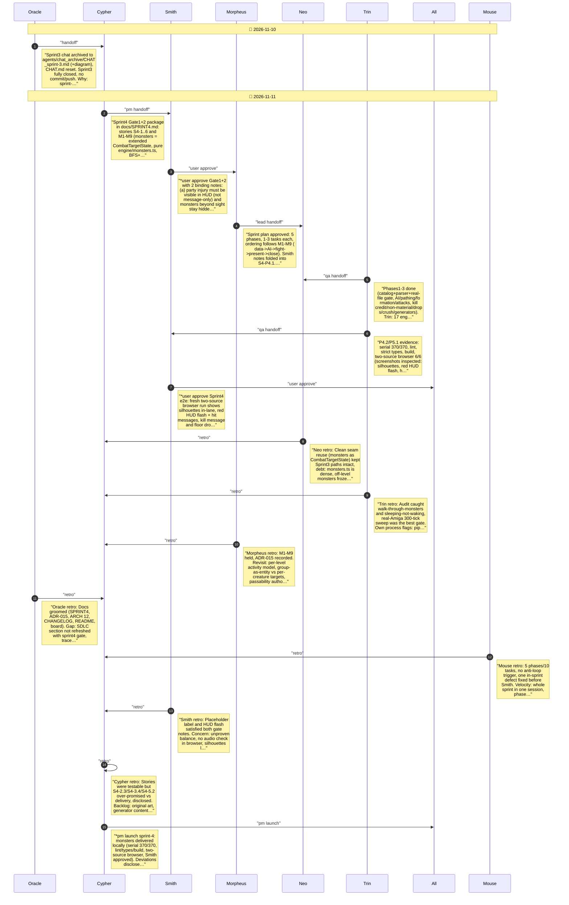

# CHAT_sprint-4 — Sprint Archive

## Summary

Delivered Sprint 4 monster ecology: 27-type catalog, Amiga creature parsing with real-file gate, deterministic hunting AI with subcell groups, two-way combat with kill credit/drops/non-material rules, door crushing, generator engine, placeholder-art viewport/HUD/automap presentation. Trin's audit fixed party walk-through and sleep wake-up. Serial 370/370, lint/types/build and two-source actual-browser gate passed; Smith approved; seven retros recorded. Judge trace ran with process flags (not a pass). Disclosed limits: approximate stats, direct ranged strikes, no shipped generators, only party level simulated. No commit/push/release.

