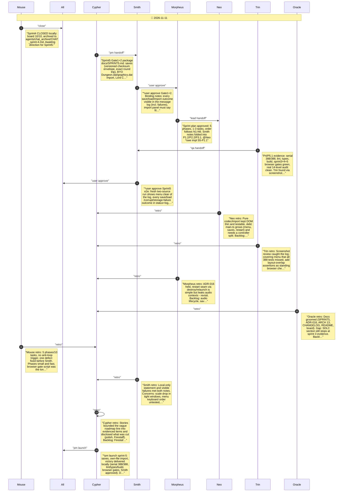

# CHAT_sprint-5 — Sprint Archive

## Summary

Delivered Sprint 5: versioned checksummed saves (slot/export/open) with typed failures, local-only Dungeon.dat/graphics.dat import with restart seam, Lord Chaos victory ending, real 14-level campaign audit, and a two-source browser gate. Browser screenshot review caught the menu covering the message log; fixed with a menu strip and an overlap assertion. Serial 388/388, lint/types/build green; judge trace ran with process flags (not a pass). Seven retros recorded. Limits: Firestaff script, one save version/slot, imports not persisted, polish bounded to audit. No commit/push.

