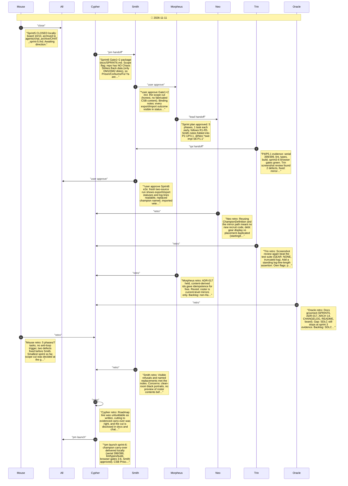

# CHAT_sprint-6 — Sprint Archive

## Summary

Delivered Sprint 6 as champion carry-over: versioned checksummed roster export of living champions, strict validation, content-id based Hall mirror placement via IMPORT_ROSTER, recruit through the existing mirror flow (Resurrect keeps skills/gear), menu controls with visible status. Scope was cut at the gate because the repo has no Chaos Strikes Back data: Prison, Corbums and Ful Ya were not invented. Screenshot review caught GEAR: NONE on imported veterans and truncated log lines; both fixed. Serial 399/399, lint/types/build, Sprint 3-6 two-source browser gates green; judge trace ran with process flags (not a pass). Seven retros recorded. No commit/push.

