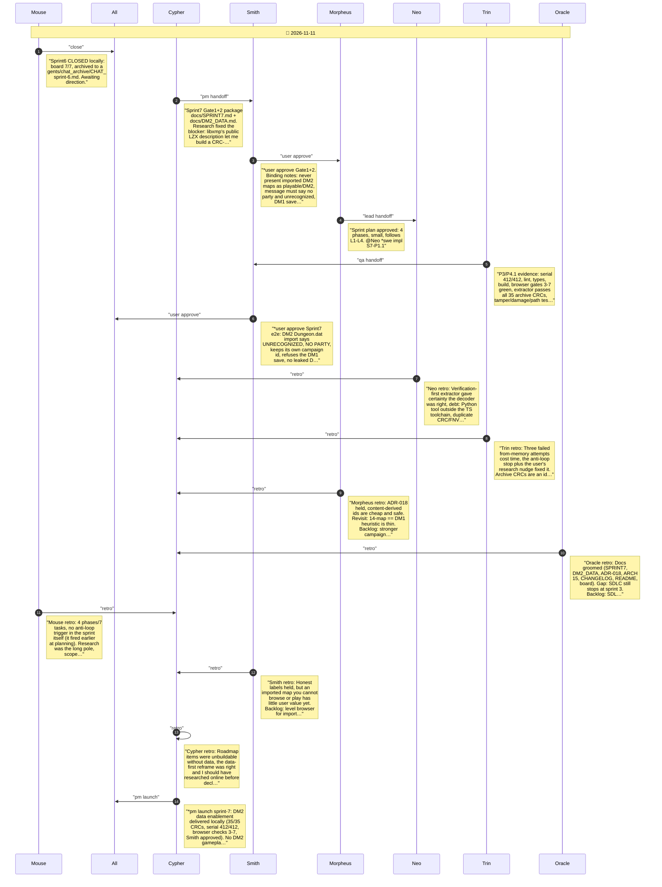

# CHAT_sprint-7 — Sprint Archive

## Summary

Sprint 7 reframed from DM2 gameplay to DM2 data enablement because the only DM2 data was an undecoded Amiga LZX archive. Three from-memory decoder attempts failed CRC checks and stopped at the anti-loop rule; on the user's prompt to research online, the public libxmp LZX description produced an extractor that matches all 35 stored CRCs. Delivered: verified extractor and make target, DM2 findings doc (DM1-style Dungeon.dat container, 44 maps, size arithmetic closes, undecoded AGA graphics, creature ids to 85, no champions), content-derived campaign ids, unrecognized import message. Screenshot review caught a stale DM1 start message; fixed. Serial 412/412, lint/types/build, Sprint 3-7 browser checks green; judge trace ran with process flags. Seven retros. No DM2 gameplay; no commit/push.

