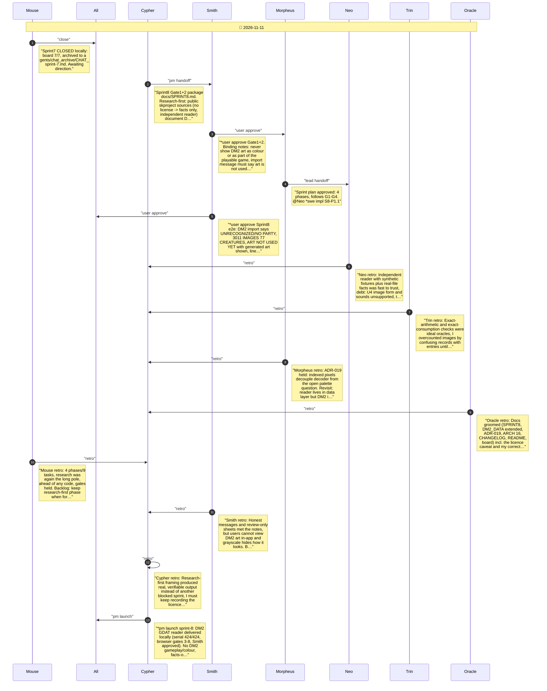

# CHAT_sprint-8 — Sprint Archive

## Summary

Sprint 8 was research-first: online research found the public skproject sources describing DM2's GDAT GRAPHICS.DAT (unlicensed, so facts only). An independent TypeScript reader was written and verified: container arithmetic closes to the byte (3,493,879), 10,045 directory records, text decodes (THORN DEMON, VORTEX; every DUNGEON.DAT creature id named), 3,011 distinct images decode with the encoding's own self-check (2,060 primary + 951 overlay, 0 failures), reviewed visually in grayscale. A guessed palette was rejected, so no colour is claimed. Import now recognizes the DM2 graphics file honestly with generated art kept; bobp make dm2-sheet writes review sheets. Trin corrected an early overcount (records vs entries). Serial 424/424, lint/types/build, Sprint 3-8 browser checks green; judge trace ran with process flags. Seven retros. No DM2 gameplay; no commit/push.

