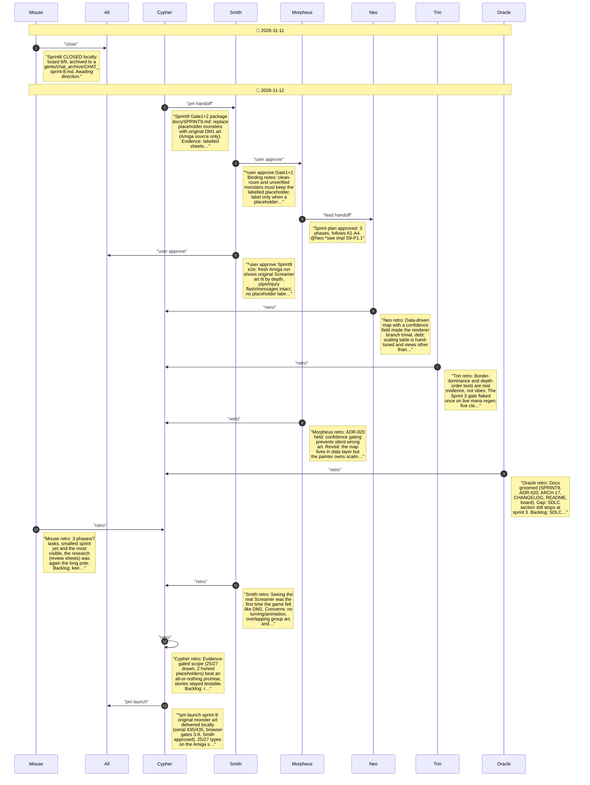

# CHAT_sprint-9 — Sprint Archive

## Summary

Sprint 9 replaced placeholder monsters with original DM1 art on the original-data source. Index-labelled review sheets showed creature sprites at atlas 446-532 in monster-type order with up to four views; the real Dungeon.dat agreed with the type order (screamers on levels 1-4, dragon on level 13). A confidence-gated map draws 25 of 27 types (front view, depth scale, depth lighting, border-derived transparency); Materializer and Water Elemental stay placeholders. Evidence tests pin indices, contiguity, border dominance and depth order. Browser checks confirm real Screamer art and label logic for both sources. The Sprint 3 gate flaked once on live mana regen and was corrected to assert mana is never spent. Serial 435/435, lint/types/build green; judge trace ran with process flags. Seven retros. No commit/push.

