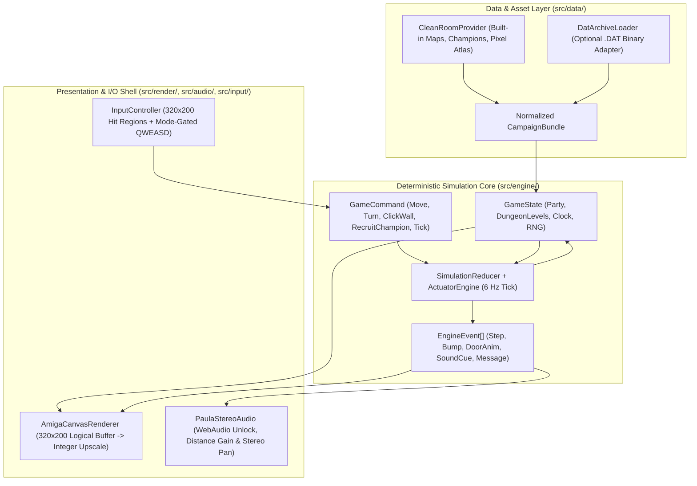
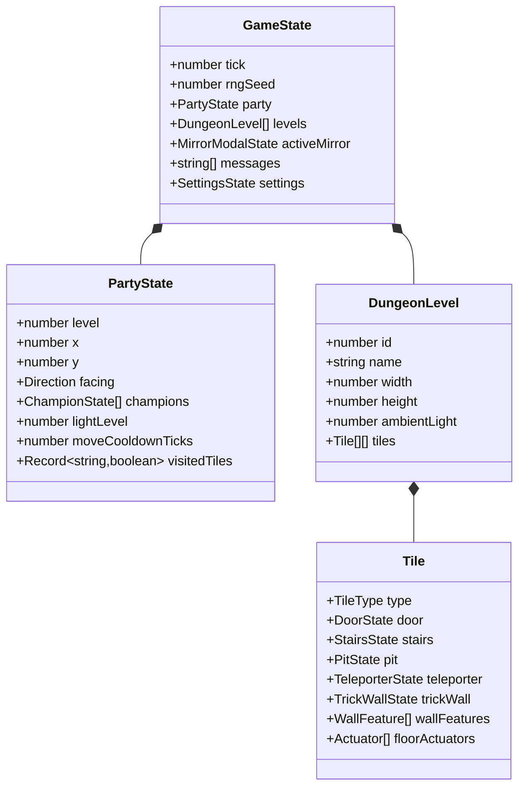
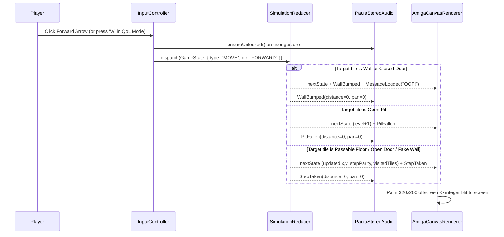

System architecture for the web-based Amiga Dungeon Master trilogy implementation.

TLDR:
    Impact: Establishes a hexagonal TypeScript architecture separating the pure 6 Hz simulation core from the 320x200 Amiga Canvas renderer, Paula Web Audio synth, and Dual-Mode campaign adapters.
    Next Steps: Complete Smith Gate 2 UX review, break Sprint 1 into 1-3 task phases in task.md via Mouse, and begin Neo TDD implementation.

# Project Architecture (`docs/ARCH.md`)

This document is the binding architectural specification for **Dungeon Master (Amiga Trilogy)**, maintained by **Morpheus**.

## 1. System Overview
`dungeon-master` is a zero-install browser implementation of FTL Games' *Dungeon Master*, *Chaos Strikes Back*, and *Dungeon Master II: The Legend of Skullkeep*. It pairs a **pure, headless, deterministic TypeScript game simulation** (~6 Hz classic FTL tick rate) with a **pixel-accurate 320×200 HTML5 Canvas painter** and a **spatial stereo Web Audio synthesizer**.

## 2. Architectural Principles
1. **Strict Simulation / Presentation Separation (Hexagonal Core)**: `src/engine/` has **zero** imports from DOM, `window`, `HTMLCanvasElement`, or `AudioContext`. All rules, ticks, movement, triggers, inventory, magic, and AI operate on plain serializable state and emit typed `EngineEvent` records — enabling 100% deterministic headless unit/integration tests in Vitest and trivial save-game serialization.
2. **Dual-Mode Campaign & Asset Boundary (Original Amiga ADF Primary + Clean-Room Fallback)**: The simulation and renderer consume a normalized `CampaignBundle` (`DungeonData`, `ChampionDef[]`, `ItemDef[]`, `GraphicsAtlas`, `PcmSoundBank`). When `Dungeon-Master_Amiga_EN.zip` (Amiga v2.0 `[HD].adf`, standard `DOS\x00` OFS image) is present, our build/runtime pipeline extracts `/DM/graphics.dat` (`411,960` bytes, **575 uncompressed Amiga planar `IMG1`/`IMG5` graphics + 8-bit PCM audio items**) and `/DM/Dungeon.dat` (`25,006` bytes, **all 14 original Big-Endian dungeon levels & 24 Hall of Champions heroes**) directly—giving 100% genuine 1988 Amiga artwork, sound effects, and maps from Sprint 1! `CleanRoomProvider` remains available as a headless test fixture and zero-asset fallback.
3. **Pixel-Authentic 320×200 Logical Framebuffer**: All UI hit-testing and drawing occur in canonical `320×200` Amiga coordinates (`imageSmoothingEnabled = false`), scaled by integer factors (`2x`, `3x`, `4x`+) onto the host viewport. `InputController` translates client pointer events via `canvas.getBoundingClientRect()` into `[0..319, 0..199]` so letterboxing never offsets clicks on small wall switches.
4. **Mode-Gated UX (Purist Default + Explicit QoL)**: `SettingsState` defaults to `purist1988` rules while allowing instant non-destructive toggling of QoL keyboard bindings (`QWEASD`), parchment automap (`M`), and audio mute.

## 3. Component Diagram



## 4. Class & Data Structures



### Canonical `320×200` Amiga Layout Regions
| Region | Logical Rect `(x, y, w, h)` | Purpose |
|--------|-----------------------------|---------|
| **Champion Status Bar** | `(0, 0, 320, 29)` | 4 champion boxes (`4 × 68px` at `x = 0..271`: Name, Health/Stamina/Mana bars, Left/Right hands) + top-right utility zone (`x = 272..319`) for Sleep/Save/QoL/Audio pills without overlapping champion slots |
| **3D Dungeon Viewport** | `(0, 33, 224, 136)` | Pseudo-3D perspective corridor (depth 3 back-to-front painter, 6-level torchlight shading, interactive wall/door/mirror click hotzones, modal overlay for Mirror / Automap) |
| **Right Control Deck** | `(224, 33, 96, 136)` | Party formation 2×2 icon, Rune/Weapon panels (Sprints 2–3), and the classic 6-cell Movement Arrow Pad `(224, 124, 96, 45)` |
| **Message & Status Strip** | `(0, 169, 320, 31)` | Scrolling Amiga bitmap-font dungeon log (`"OOF!"`, mirror inscriptions, QoL key legend when QoL enabled) |

## 5. Sequence & Interaction Flows



## 6. Technical Stack & Directory Layout
- **Language**: TypeScript 5.x (`strict: true`, ES2022 modules)
- **Bundler / Dev Server**: Vite 6.x
- **Test Framework**: Vitest (`node` environment for headless fast simulation + canvas mock tests)
- **Linter / Typecheck**: ESLint 9 (flat config) + `tsc --noEmit`
- **Build Automation**: GNU `Makefile` invoked exclusively through `bobp make <target>`:
  - `bobp make setup` — install `npm` dependencies and update `via` index
  - `bobp make test` — run Vitest suite
  - `bobp make lint` — run ESLint + `tsc --noEmit`
  - `bobp make build` — run `tsc --noEmit` + `vite build`
  - `bobp make dev` — launch Vite dev server
  - `bobp make tldr` — run `bobp tldr`

```text
dungeon-master/
├── Makefile
├── package.json
├── tsconfig.json
├── vite.config.ts
├── index.html
├── docs/
│   ├── PRD.md
│   ├── USER_STORIES.md
│   ├── ARCH.md
│   └── DECISIONS.md
├── src/
│   ├── main.ts                 # Browser bootstrap & 60 FPS loop + 6 Hz tick accumulator
│   ├── engine/                 # Pure headless simulation (types, clock, movement, actuators, lighting)
│   ├── data/                   # CleanRoomProvider (Level 0 Hall of Champions + Level 1) & .DAT adapter types
│   ├── render/                 # 320x200 logical framebuffer, Amiga palette, pseudo-3D painter, HUD, automap
│   ├── audio/                  # Web Audio procedural Paula synth, gesture unlock, spatial panner
│   └── input/                  # 320x200 coordinate mapper, mouse hitboxes, mode-gated QWEASD controller
└── tests/                      # Deterministic Vitest unit & vertical-slice integration tests
```

## 7. Refactoring Status & Technical Debt
- **Greenfield Baseline**: Sprint 1 establishes the foundational interfaces (`GameState`, `GameCommand`, `EngineEvent`, `CampaignBundle`) so Sprints 2–4 (Inventory, Runes, Monsters) plug into `SimulationReducer` without rewriting `ViewportPainter` or `InputController`.
