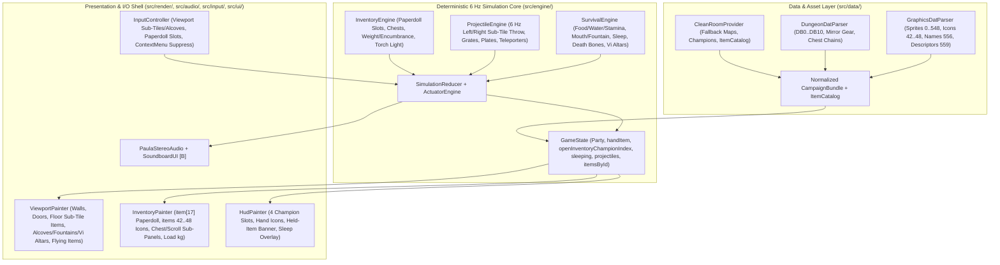

System architecture for the web-based Amiga Dungeon Master trilogy implementation, including Sprint 2 gameplay and the offline indexed sprite-export follow-up.

TLDR:
    Impact: Extends the hexagonal 6 Hz TypeScript core and 320x200 Amiga Canvas renderer with FTL's 180-entry ObjectDescriptor catalog (graphics.dat items 556 & 559 + icon sheets 42..48), DB5..DB10 sub-tile/alcove world items, Champion Paperdoll Inventory (item[17] + sub-panels 23/25), 6 Hz corridor projectile physics, and Food/Water/Stamina/Sleep/Vi Altar survival systems.
    Next Steps: Offline export implementation and QA/architecture/mechanism review passed; retain task.md as the final gate and release-status authority. Runtime lighting and campaign-pack loading remain future work.

# Project Architecture (`docs/ARCH.md`)

This document is the binding architectural specification for **Dungeon Master (Amiga Trilogy)**, maintained by **Morpheus**.

## 1. System Overview
`dungeon-master` is a zero-install browser implementation of FTL Games' *Dungeon Master*, *Chaos Strikes Back*, and *Dungeon Master II: The Legend of Skullkeep*. It pairs a **pure, headless, deterministic TypeScript game simulation** (~6 Hz classic FTL tick rate) with a **pixel-accurate 320×200 HTML5 Canvas painter** and a **spatial stereo Web Audio synthesizer**.

## 2. Architectural Principles
1. **Strict Simulation / Presentation Separation (Hexagonal Core)**: `src/engine/` has **zero** imports from DOM, `window`, `HTMLCanvasElement`, or `AudioContext`. All rules, ticks, movement, triggers, inventory, throwing projectiles, encumbrance, survival vitals, magic, and AI operate on plain serializable state and emit typed `EngineEvent` records — enabling 100% deterministic headless unit/integration tests in Vitest and trivial save-game serialization.
2. **Dual-Mode Campaign & Asset Boundary (Original Amiga ADF Primary + Clean-Room Fallback)**: The simulation and renderer consume a normalized `CampaignBundle` (`DungeonData`, `ChampionDefinition[]`, `ItemCatalog`, `WorldItemInstance[]`) and `GraphicsBundle`. When `Dungeon-Master_Amiga_EN.zip` is extracted via `scripts/extract_assets.py`, `graphics.dat` supplies all **535 FTL 4bpp RLE sprites** (including `item[17]` paperdoll, `items 23/25` scroll/chest panels, `items 42..48` `16×16` item icon sheets, `item[556]` 199 item names, `item[558]` master blitter rects, and `item[559]` 180-entry `ObjectDescriptor` table) and **33 `5500 Hz` Paula PCM sounds**, while `Dungeon.dat` supplies **all 14 levels**, **24 Champions + starting gear chains**, and **`DB5..DB10` world items**. `CleanRoomProvider` supplies a complete legal fallback catalog and starter items when `.dat` files are absent.
3. **Pixel-Authentic 320×200 Logical Framebuffer & Shared Hitboxes**: All UI hit-testing and drawing occur in canonical `320×200` Amiga coordinates (`src/render/layout.ts` `LAYOUT_RECTS`), scaled onto the host viewport with crisp nearest-neighbor pixels. `InputController` translates pointer events (including suppressed right-click `contextmenu` and trackpad-friendly portrait header clicks) into `[0..319, 0..199]`.
4. **Mode-Gated UX (Purist Default + Explicit QoL)**: `SettingsState` defaults to `purist1988` rules while allowing instant non-destructive toggling of QoL keyboard bindings (`QWEASD`, `1–4` champion inventory sheets, `Z` sleep entry, `M` parchment automap, `ESC` modal/panel close) and audio mute.

---

## 3. Component Diagram (Sprint 2 Extensions)



---

## 4. Sprint 2 Data & Simulation Architecture

### 4.1 Empirically Verified FTL Item Catalog (`graphics.dat` + `Dungeon.dat`)
Inspection of the extracted Amiga binaries confirms an exact 1:1 data pipeline:
1. **`item[556]` (`1,847` bytes)**: High-bit-terminated ASCII table of **199 canonical item names** (`0..198`: `0..3 COMPASS`, `4..7 TORCH`, `8..9 WATERSKIN`, `30..31 SCROLL`, `32..66 WEAPONS`, `67..119 CLOTHES/ARMOR/SHIELDS`, `144..145 CHEST`, `147/198 BONES`, `148..167 POTIONS/BOMBS`, `168..175 FOOD`, `176..191 KEYS`, `195 EMPTY FLASK`).
2. **`items 42..48` (`7 × 256×32` sheets)**: Each sheet holds `16 columns × 2 rows = 32` `16×16` 4bpp icons (`224` slots total). Icon index `N` (`0..198`) slices directly from `sheet = 42 + Math.floor(N / 32)`, `local = N % 32`, `col = local % 16`, `row = Math.floor(local / 16)`.
3. **`item[559]` (`offsets 1959..3038`, `180 × 6` bytes)**: Master `ObjectDescriptor` table ordered contiguously as:
   - `0..22` (`23` entries): `DB7` Scroll (`0`), `DB9` Chest (`1`), `DB8` Potions/Flasks/Bombs (`2..22`)
   - `23..68` (`46` entries): `DB5` Weapons (`subtype 0..45`)
   - `69..126` (`58` entries): `DB6` Clothes/Armor (`subtype 0..57`)
   - `127..179` (`53` entries): `DB10` Misc/Food/Coins/Gems/Keys/Bones (`subtype 0..52`)
   Each 6-byte record provides `[iconIndex, floorSpriteDescIndex, subtypeStatIndex, allowedSlotsHi, allowedSlotsLo, flags]`.
4. **`Dungeon.dat` `DB5..DB10` Instance Records & Level 0 Champion Gear**:
   - Every world item receives a deterministic `ItemInstanceId` (`string`) stored in `GameState.items: Readonly<Record<ItemInstanceId, ItemInstance>>`.
   - `Tile` stores `floorItems: Readonly<Record<SubTileQuadrant, readonly ItemInstanceId[]>>` (`0=NW, 1=NE, 2=SE, 3=SW`) and `wallItems: Readonly<Record<Direction, readonly ItemInstanceId[]>>` (for alcoves, sconces, Vi Altars).
   - `DB9` Chests (`8` bytes: `w0=next`, `w1=childChainHead`) recursively populate `ItemInstance.contents: readonly ItemInstanceId[]` (max `8` items; chests cannot nest inside chests).
   - `DB7` Scrolls (`4` bytes) resolve their `DB2` text index into `ItemInstance.scrollText: readonly string[]`.
   - On Level 0 (`Hall of Champions`), items chained behind each `rawType=127` Champion Mirror actuator on the same `face` populate that `ChampionDefinition`'s authentic starting equipment (`Torso`, `Legs`, `Feet`, `Hands`, `Backpack`) upon Resurrect/Reincarnate!

### 4.2 Paperdoll Inventory, Equipment Slots & Encumbrance (`src/engine/inventory.ts` + `src/render/inventoryPainter.ts`)
- **Champion Equipment Schema (`ChampionInventory`)**:
  - Named slots: `head`, `neck`, `torso`, `legs`, `feet`, `leftHand`, `rightHand`, `pouch1`, `pouch2`, `quiver1..4` (`Record<EquipSlotId, ItemInstanceId | null>`) + `backpack: readonly (ItemInstanceId | null)[]` (`17` slots).
  - **Persistent Cursor Hand (`GameState.handItem: ItemInstanceId | null`)**: Independent of whether `openInventoryChampionIndex: number | null` is open or closed! Picking up an item puts its ID in `handItem`; clicking an empty valid slot places it; clicking an occupied compatible slot **swaps** `handItem` with the slot's item! Invalid slot drops keep `handItem` unchanged and log `"CANNOT EQUIP THERE"`.
  - **Container / Scroll Sub-Panels (`item[23]` / `item[25]` at screen `(80, 85, 144, 73)`)**:
    - When `openContainerId` (a Chest placed in the inspect/container zone or right-clicked/clicked in hand) is active, the right sub-panel renders the 8 irregularly placed open-chest slots (`item[25]`).
    - When a Scroll is held in `handItem` or placed in the Eye/inspect slot, the right sub-panel renders the open scroll parchment (`item[23]`) with its `DB2` inscription lines; otherwise it renders Champion Stats (`STR`, `DEX`, `WIS`, `VIT`, `ANTI-MAGIC`, `ANTI-FIRE`), Food/Water bars, and `LOAD X.X / MAX Y.Y KG`.
  - **Weight & Encumbrance**:
    - `championLoadTenths` sums equipped + backpack + nested chest contents. Morpheus clarification (2026-11-03): the cursor hand, including nested held-chest contents, belongs to the stable living party leader and is counted exactly once, independently of the inventory being viewed. This invariant was implemented and verified in final QA on 2026-11-03.
    - `maxLoadTenthsKg` derives from `Champion.strength` (attenuated when wounded/low stamina).
    - Yellow highlight when `load > 0.75 * maxLoad` (`+1` tick move cooldown), Red highlight when `load > maxLoad` (`+2..4` ticks move cooldown + elevated step stamina cost).

### 4.3 Sub-Tile World Items, Wall Features & 6 Hz Corridor Throw Physics (`src/engine/projectiles.ts`)
- **Perspective Sub-Tile Mapping**:
  - Relative to party `facing` (`f`), any tile's 4 world quadrants `(0=NW, 1=NE, 2=SE, 3=SW)` map deterministically to view-relative positions:
    - `BACK_LEFT = (f + 3) & 3` (closest left to player), `BACK_RIGHT = (f + 2) & 3` (closest right to player)
    - `FRONT_LEFT = f`, `FRONT_RIGHT = (f + 1) & 3` (far left / far right of that tile)
  - Standing on tile `(x, y)` (`depth 0`), the player can directly click & pick up/drop floor stacks on `FRONT_LEFT` (`x = 16..96, y = 136..166`) and `FRONT_RIGHT` (`x = 128..208, y = 136..166`), or click the facing `depth 1` **Wall Alcove / Vi Altar / Fountain / Keyhole** (`x = 76..148, y = 68..112`).
- **Corridor Throw Command (`THROW_HAND_ITEM { side: 'LEFT' | 'RIGHT' }`)**:
  - Clicking the upper half of the `224×136` 3D viewport (`y = 33..108`, `x < 112` = `'LEFT'`, `x >= 112` = `'RIGHT'`) while `handItem !== null` and `openInventoryChampionIndex === null` launches a `ProjectileState` in `GameState.projectiles`:
    - Starts entering `(party.x + dx, party.y + dy)` along the `LEFT` or `RIGHT` corridor lane with `kineticEnergy` computed from thrower `strength` vs. `item.weightTenthsKg` (clamped so heavy boulders drop quickly and daggers/stars fly several tiles), costing thrower Stamina and playing `THROW_SWOOSH` (synthesized default; sample-remappable in the soundboard).
    - Each 6 Hz tick, active projectiles advance along their sub-tile lane:
      - Solid walls or closed `WOODEN`/`METAL`/`RA_MAGIC` doors (`progress >= 2`) halt the projectile immediately, dropping the item onto the tile just before the obstacle.
      - Closed `IRON_GRATE` doors allow small/slender projectiles (`passThroughGrate: true`, e.g., daggers, arrows, stars, keys, coins, rocks) to pass right through!
      - Active `TELEPORTER` tiles (`scope` matching `'OBJECTS' | 'PARTY_AND_OBJECTS' | 'ALL'`) teleport and rotate the projectile in flight!
      - When `kineticEnergy <= 0` (or over an open `PIT`, falling to `level + 1`), the item lands in the tile's `floorItems[quadrant]` stack and triggers any object-sensitive floor `Actuator` (pressure plate) on that tile!

### 4.4 Survival Vitals, Consumables, Sleep & Vi Altars (`src/engine/survival.ts`)
- **Food, Water & Stamina Loop**:
  - Each living champion tracks `food` (`-1024..2048`, starting ~`1500`) and `water` (`-1024..2048`, starting ~`1500`).
  - Periodic 6 Hz survival ticks decrement `food` and `water`; when `food > 0 && water > 0`, `stamina` regenerates (`+vitality` factor) and surplus stamina slowly heals `health` & `mana` (`wisdom` factor). When `food < 0` or `water < 0`, gauges turn red and drain `stamina` -> `health`.
  - **Mouth & Fountains**: Dropping food/water-flask/waterskin on the Paperdoll **Mouth** (`CONSUME_HAND_ITEM`) restores `food`/`water` (`Waterskin` decrements charges `3 -> 2 -> 1 -> Empty`, `Water Flask -> Empty Flask`) and emits `GULP` audio cue. Clicking a **Wall Fountain** with empty hand restores party/active champion `water`; clicking with an `Empty Waterskin` or `Empty Flask` refills it!
  - **Torch Burn**: Every `N` ticks (`~24` ticks per charge stage), lit `TORCH` items equipped in living champions' `leftHand`/`rightHand` decrement `charges` (`15 -> 0`), stepping icon `4 -> 5 -> 6 -> 7` (`Burned Out`) and recomputing `party.torchLight` (`0..5`, plus `Illumulet` neck bonus!).
- **Sleep (`GameState.party.sleeping: boolean`)**:
  - Triggered via top-right/HUD `SLEEP` button (`Z` in QoL Mode); forbidden while `activeMirror !== null`.
  - Darkens the `224×136` viewport with `"SLEEPING — CLICK OR PRESS ANY KEY TO WAKE"`, uses a 3× recovery cadence (every 2 ticks instead of 6) while halving metabolic burn (every 8 ticks instead of 4), as clarified by Morpheus on 2026-11-03; this satisfies AC 2.3.2, and wakes immediately on any click, key press, or damage event.
- **Champion Death, Bones & Vi Altar Rebirth**:
  - When a champion's `health <= 0` (pit fall damage, crushing door when standing under a closing door, or starvation), `alive` becomes `false` (`health = 0`), all equipped + backpack items drop onto `(party.x, party.y)` floor quadrant alongside a generated `BONES` `ItemInstance` tagged with `championId` (`"<NAME> BONES"`), and top-bar slot switches to the fallen skull card (`item[37..39]` / clean-room skull).
  - Placing `<NAME> BONES` into a facing **Vi Altar** (`WallFeature.kind === 'VI_ALTAR'`) consumes the bones, emits `CHAMPION_REVIVE`, and restores that champion to life (`health = Math.max(1, Math.floor(maxHealth / 2))`, healthy `food`/`water`).

---

## 5. Canonical `320×200` Layout & Paperdoll Hitboxes (`src/render/layout.ts`)

| Surface | Logical Rect `(x, y, w, h)` | Interaction Rule |
|---------|-----------------------------|------------------|
| **Champion Slot `0..3` Header/Bars** | `(slot*68, 0, 40, 29)` | Left-click selects party leader (or toggles inventory on header `y=0..8`); Right-click (`contextmenu` suppressed) toggles that champion's `item[17]` Inventory Sheet |
| **Champion Slot `0..3` Left / Right Hand** | `(slot*68 + 40, 10, 13, 16)` / `(+54, 10, 13, 16)` | Left-click picks up, places, or swaps `handItem` directly from top bar even when 3D viewport is active |
| **Utility Bar (`x=272..319`)** | `QOL (273,1,46,8)`, `MAP (273,10,46,8)`, `ZZZ (273,19,22,9)`, `SFX (296,19,23,9)` | Crisp 1px-separated pills adding Purist-friendly `ZZZ` Sleep trigger alongside `QOL`, `MAP`, and Audio badge |
| **3D Viewport Hitbox Precedence** | 1. Modal/Sleep/Automap $\rightarrow$ 2. Facing Wall Feature `(72, 64, 80, 52)` $\rightarrow$ 3. Floor Drop/Pickup $\rightarrow$ 4. Throw Lanes | Prevents throwing a Key/Bones into a wall when clicking a facing Keyhole, Vi Altar, Fountain, or Alcove (HCI #5) |
| **3D Viewport Throw Zones** | Left `(0, 33, 112, 98)`, Right `(112, 33, 112, 98)` | Evaluated *after* facing wall feature hitboxes when `handItem !== null` and inventory is closed; launches Left/Right sub-tile projectile |
| **3D Viewport Floor Pickup Zones** | Front-Left `(8, 132, 96, 36)`, Front-Right `(120, 132, 96, 36)` | Picks up top item from `depth 0` `FRONT_LEFT` / `FRONT_RIGHT` quadrant when `handItem === null`, or drops `handItem` onto that quadrant |
| **Held-Item Cursor & Status** | `16×16` icon centered on logical `(mx, my)` + `HELD: <NAME> (<X.X> KG)` banner | Guarantees continuous visibility of held item identity & weight for both mouse and trackpad/QoL users (HCI #1) |
| **Paperdoll Inventory (`item[17]`)** | `(0, 33, 224, 136)` | Replaces 3D viewport when `openInventoryChampionIndex !== null`: Mouth `(56, 46, 16, 16)`, Eye `(12, 46, 16, 16)`, Close `[X]` `(209, 34, 14, 12)`, Sleep `Zzz` `(187, 34, 20, 12)`, Paperdoll body slots (`Head`, `Neck`, `Torso`, `Legs`, `Feet`, `L/R Hand`, `Pouch 1..2`, `Quiver 1..4`), `17`-slot Backpack (8 icons at screen `y=49`, 9 at `y=66`; 17px spacing), and Right Sub-Panel `(80, 85, 144, 73)` (`Stats/Load` vs `Open Chest` vs `Scroll`) |

> **Implementation Invariant**: Before hardcoding exact pixel offsets of individual `16×16` slot boxes inside `item[17]` (`224×136`) and `item[25]` (`144×73`), Neo MUST verify the exact slot box outlines against the decoded `item[17]` & `item[25]` pixel buffers in Phase 2 so icons sit 100% centered inside FTL's drawn slot frames!

---

## 6. Updated Directory Layout
```text
src/
├── main.ts                     # Browser bootstrap, 60 FPS render + 6 Hz tick loop, cursor-hand overlay
├── data/
│   ├── cleanRoomProvider.ts    # Legal fallback maps, champions, starter items & CleanRoom ItemCatalog
│   ├── dungeonDatParser.ts     # 0x8104 + 14 levels + DB0..DB10 items, Chest chains, Scroll texts, Mirror gear
│   ├── graphicsDatParser.ts    # 535 RLE sprites, items 42..48 icon slicer, item[556] names, item[559] descriptors
│   └── itemCatalog.ts          # Normalized 180-type ItemDef catalog (Dual-Mode AMIGA_DAT + CLEAN_ROOM)
├── engine/
│   ├── types.ts                # Pure state, ItemInstance, ChampionInventory, ProjectileState, GameCommand, EngineEvent
│   ├── clock.ts                # Fixed 6 Hz tick accumulator
│   ├── simulation.ts           # Top-level deterministic reducer
│   ├── inventory.ts            # Slot validation, swap/stack, Chest packing, Load/MaxLoad kg, Torch light calc
│   ├── projectiles.ts          # 6 Hz corridor throw physics, grate pass-through, teleporters, item plates
│   └── survival.ts             # Food/Water/Stamina ticks, Mouth/Fountain, Sleep, Pit/Door damage, Bones & Vi Altars
├── render/
│   ├── framebuffer.ts          # 320x200 offscreen RGBA buffer & sprite blitter
│   ├── layout.ts               # Shared 320x200 LAYOUT_RECTS (HUD, Viewport sub-tiles, Paperdoll slots)
│   ├── viewportPainter.ts      # 3D walls, doors, floor sub-tile item stacks, alcoves/fountains/altars, flying items
│   ├── inventoryPainter.ts     # item[17] Paperdoll, items 42..48 icons, Chest/Scroll sub-panels, Load kg & bars
│   ├── hudPainter.ts           # Top champion slots, hand icons, held-item banner, Sleep overlay, message strip
│   └── automapPainter.ts       # QoL parchment automap
├── input/
│   └── inputController.ts      # Contextmenu suppression, persistent handItem clicks/throws, Paperdoll & QoL 1-4/Z/ESC
├── audio/
│   └── paulaAudio.ts           # 5500 Hz SND2 spatial PCM + procedural fallback (GULP, THROW_SWOOSH, LOCK_CLICK)
└── ui/
    └── soundboard.ts           # Interactive Paula SFX Soundboard [B]
```


## 7. Sprint 2 Implementation Evidence and Limits (2026-11-03)

- `SpriteSource` owns semantic panel/icon lookup and deterministic fallback sprites. New painters use semantic keys; existing viewport walls still use original raw-index paths. The six original palettes remain decoded; section 9 describes their parametric runtime lighting replacement. The campaign-pack loader remains future work. The separate offline sprite exporter is implemented in section 8.
- Original equipment/backpack and irregular chest coordinates were measured from decoded panel border pixels, with regression checks in `tests/render/inventoryRender.test.ts`. Black scroll ink stays within parchment `(117,94,90,49)`, wraps 15 columns and shows at most six rows; overflow receives an ellipsis and inspection messages retain the transcript.
- Depth 0 floor quadrants rotate with facing; approaching projectile lanes mirror the travel-relative lane; shut solid crosswise doors occlude far-half floor items. Sleep suppresses inventory so its dark overlay remains visible.
- Cursor position is logical 320×200 pointer state supplied only to presentation. Context-menu suppression and listener teardown remain in the browser shell, not the pure engine.
- Pickup/throw/drink/lock/death cues use explicit synthesized defaults. A sound mapping of `null` means silence; synthesis is a distinct route, including in soundboard presets.
- Procedural wall ornaments/skulls and scaled icon world sprites are current art limitations. Original sprite classification, true floor artwork, saves, combat and monsters remain future scope. The trace audit is unavailable until Python `jinja2` is installed; a Makefile success masking that missing import is not audit evidence.
- Source checks and live Chromium scene/interaction checks are separate evidence. Final QA (177 aggregate tests plus 2 additional independent QA tests and lint/strict TypeScript), architecture review and Smith end-to-end approval passed on 2026-11-03; the live Chromium runner passed 27 interaction checks with no browser exceptions. Retrospective and local launch status remain in `task.md`.

### Final accepted-story completion
Side wall alcoves and contents render on inward-facing surfaces at depths0–3 with perspective projection and nearer-wall occlusion. Equipment attributes and mana capacity derive from base stats plus verified equipped effects; inventory displays effective stats and armor, and strength/regen consumers use those values. Food/water under512 warn yellow and under0 warn red. Total party wipe overlays other panels with click/Enter restart from the original runtime campaign bundle. See ADR-010 and the final acceptance report for reopened criteria and independent regressions.


## 8. Offline Indexed Sprite Export (`sprint-2-assets`)

This is an offline contributor tool, not a runtime asset migration. [The accepted scope and evidence](SPRINT_ASSET_EXPORT.md) cover AE-1–AE-8; [ADR-011](DECISIONS.md#adr-011-offline-indexed-sprite-export-and-original-palette-requirement-2026-11-03) requires complete original palette metadata. The browser game continues to decode DAT assets and use its existing masks/palettes.

### Components and boundary

- [`src/tools/spriteExport.ts`](../src/tools/spriteExport.ts): pure deterministic 4-bit indexed PNG encoding and schema1 manifest construction, native `Buffer`/zlib, sparse verified categories/semantic labels.
- [`src/tools/spriteExportWriter.ts`](../src/tools/spriteExportWriter.ts): exporter-side complete-container/palette validation and owned local file publication; existing runtime parser remains unchanged.
- [`scripts/sprite-export-runtime.mjs`](../scripts/sprite-export-runtime.mjs): existing Vite SSR loader with HMR/watch disabled and no listening server; no assumption of native Node TypeScript import resolution.
- [`scripts/export-sprites.mjs`](../scripts/export-sprites.mjs): thin CLI publisher with actionable help/failures. [`scripts/review-sprite-export.mjs`](../scripts/review-sprite-export.mjs) independently checks actual files through native Chromium; it never republishes or repairs them.

### Artifacts and input rules

`bobp make export-sprites` reads local `public/assets/extracted/dm1/graphics.dat` and emits `build/sprites/<category>/<index>_<width>x<height>.png` plus `manifest.json`. `SPRITE_INPUT`/`SPRITE_OUTPUT` override quoted paths; `ARGS=--help` explains the interface. A real CLI source must include complete record562 (at least1470bytes); absent/short records cannot silently select default palette ramps. Pure arbitrary-count fixtures inject explicit palettes instead.

One PNG corresponds to each raw decoded sprite; atlases remain atlases, and sounds/font/metadata are not extra sprites. The manifest records sorted indices, dimensions, relative paths, sparse semantic keys, full source/PNG hashes and original brightest16-color palette. There are no timestamps, absolute host paths or light-ramp copies. Palette index0 exports at alpha0, others at alpha255. **This raw transparency policy is not a claim of drop-in replacement for runtime masks such as index10.**

Publication preflights ownership/hashes/collisions in a dedicated resolved ignored-build subtree, stages files, then publishes the manifest after its PNGs. It preserves unrelated sentinels and source bytes; it neither recursively removes arbitrary directories nor promises a whole-tree I/O rollback.

### Independent evidence and limits

`bobp make export-sprites-review` reads the actual exported files, verifies all16PLTE colors and normalizedtRNS entries (including unused colors), and compares every native Chromium-decoded RGBA pixel with parser-derived source indices/brightest colors. Transparent pixels normalize toRGBA0. Separate ignored `build/sprite-export-review/` holds the report, panel17/atlas42/wall87 samples and overview. Reports start incomplete and record failure rather than retaining stale success; all evidence destinations reject unsafe aliases.

The supplied archive exported535sprites; final native review checked1,690,768pixels with unchanged source and no browser errors at18:18:07 on2026-11-03. Earlier226aggregate tests/build preceded the focused strict-palette correction. Final four affected suites31/31 passed18:17:20, followed by lint/strict TypeScript18:17:39. This is not a claim of a fresh226-suite run after the last guard. Trin, Morpheus and Tank approved implementation; final Smith/artifact and close status are recorded in root `task.md` and chat. No new dependency/runtime pin/CI/deployment is implied. Full classification, parametric lighting and campaign-pack loading remain separate work.


## 9. Parametric Dungeon Lighting (2026-11-03)

`src/render/lighting.ts` validates and freezes a copied `lighting.json` profile at import. `createLightingContext` precomputes light/depth brightness and tint; `lightRgb`, `lightPalette` and `lightRgba` share one color formula. RGB arrays and source buffers remain unchanged; RGBA alpha is copied exactly. These pure helpers do not load images or blend sprites.

`getViewportLightPalette` requires sixteen source colors and derives them from `getUiPalette`, never from a historical dark ramp. The viewport uses four depth palettes for world sprites, side projection, procedural geometry and text. Source masks and cropping/flipping/scaling remain framebuffer responsibilities. UI composition still occurs afterward with the full-bright palette; no framebuffer-wide dark overlay or new emissive rule is introduced.

Gameplay light, torch charge, simulation ticks and source decoding/export are unchanged. See [ADR-012](DECISIONS.md) and [lighting scope/evidence](SPRINT_LIGHTING.md) for the configuration formula and current acceptance status. Runtime PNG/truecolor loading, semantic classification and campaign packs remain separate work.


## 10. Source-Aware Sprite Catalog (2026-11-03)

`src/data/spriteCatalog.ts` owns the existing four panel aliases, export categories and item-icon addresses. The parser extraction helper and `SpriteSource` share the address policy while retaining their existing bounds/clamp/fallback behavior. `buildSpriteCatalog` joins actual decoded indices and dimensions with sparse verified facts only for original DM1 provenance; generated records remain unclassified even when numeric IDs match. Legacy export category and verified identity status are separate concepts.

Each usage carries a raw source index, optional crop, evidence and an opaque/index0/index10 or auxiliary-mask policy. Door records additionally name sprite301 as a conditional bashed-door mask. Derived icon numbers and portrait IDs do not become raw source IDs. Alias-only records have no invented active painter policy. The raw exporter still emits the same schema1 manifest and PNG bytes; metadata is a separate inspection overlay.

The G inspector provides search, combined filters, persistent selection/details and explicit raw-versus-usage previews. Unknowns allow raw interpretations without inferred runtime policies. Source palette ramps remain reference choices, separate from parametric world lighting. Runtime dependency direction remains one-way: catalog data/policy → pure inspection rendering → DOM composition; the review script stays outside runtime source.

Delivered evidence on 2026-11-06 covers `535` measured records (`39` verified roles, `496` unclassified), a generated-source guard, `570` actual-browser checks and `9` inspected captures with zero exceptions, `3` independent inspection tests, the final `268`-test aggregate and production build. Source/manifest hashes and all raw PNG bytes remained compatible. See [ADR-013](DECISIONS.md) and [catalog acceptance status](SPRINT_SPRITE_CATALOG.md). Full semantic identification of all 535 sprites, painter migration and runtime image/campaign-pack loading remain future work.
