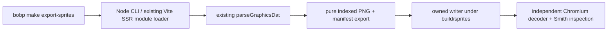

# Asset Export Sprint — `sprint-2-assets`

Deliver a local, inspectable sprite export before the later lighting/campaign-pack work. This is the bounded ADR-009 follow-up discussed after Sprint 2; the combat/progression roadmap retains the name **Sprint 3**.

Status: combined Cypher/Morpheus Tier 2 plan implemented. Trin QA, Morpheus architecture and Tank mechanism reviews passed; Smith final CLI/PNG approval and local close follow grooming. Root task.md tracks final lifecycle status. This document defines scope/acceptance; **root `task.md` alone tracks implementation tasks**. No unchanged-code baseline tests were run.

## Product stories and acceptance evidence

**Story A:** As an artwork maintainer, I can export the decoded original sprite collection into individual PNG files and a manifest so I can inspect, classify and eventually replace artwork without deciphering the binary archive.

**Story B:** As a contributor, I can run the exporter through project automation, understand missing-input errors, and rerun it without damaging other local files.

| ID | Accepted result | Required evidence |
|---|---|---|
| AE-1 | `bobp make export-sprites` reads local `public/assets/extracted/dm1/graphics.dat` by default and writes `build/sprites/<category>/<index>_<width>x<height>.png` plus `manifest.json`. Each decoded `GraphicsBundle.sprites` entry appears once; do not export sounds/font/raw metadata as sprites or split an atlas into extra files. | Manifest/file-count equality against the existing parser; the current supplied archive should yield 535 PNGs. Synthetic inputs test other counts rather than hard-coding 535. |
| AE-2 | Indexed PNG preserves original dimensions, every 4-bit source pixel index and the brightest original 16-color palette. Palette index 0 has alpha 0; indices 1–15 are opaque. No lighting-ramp copies. | PNG structure/index tests plus independent Chromium image decoding and RGBA comparison with parser-derived expected colors/alpha; cover dimensions, transparent pixels and every exported sprite when original assets exist. |
| AE-3 | Deterministic manifest schema version 1 records source filename/hash, sorted numeric index, dimensions, category, relative PNG path and verified semantic key(s). Unknown labels remain explicitly unclassified. No generated time or absolute machine path. | Two identical exports have byte-identical PNGs and manifest; all manifest paths resolve and use portable filenames. |
| AE-4 | Categories/semantic labels are evidence-based. Begin with existing verified panel mappings and known atlas/dungeon groups; use `unclassified` for the rest. | Mapping checks against `SpriteSource` and existing documented indices; unknown index fixture stays unclassified. No claim that all 535 sprites have semantic names. |
| AE-5 | Missing/unreadable/corrupt or truncated input fails nonzero with a concise actionable message; no clean-room substitution and no false successful count. Help explains default input/output and local-only assets. Real CLI input must contain complete palette record 562; absent or undersized palette metadata is rejected rather than using parser defaults. Reduced-count codec/manifest fixtures provide their own explicit palettes. | Actual CLI help, missing-input and corrupt-input invocations; failure before publication leaves previous successful output intact. Include a container whose header/table is readable but a later record overruns its bytes, so a partial parse cannot be reported as success. |
| AE-6 | Reruns write only exporter-owned output. Never recursively delete an arbitrary directory or overwrite unrelated files. Generated art stays under ignored `build/`; input bytes are untouched. | Sentinel-file preservation, input hash preservation, repeated export/file-count checks and `git check-ignore` evidence. If stale owned files are pruned, accept only validated prior manifest paths under the owned output root. |
| AE-7 | A contributor can inspect a generated PNG normally; transparent shapes, palette and dimensions are plausible, and CLI output points to the manifest/count. | Smith runs the real CLI and independent decoder review, opens representative UI/torch/wall PNGs, and records explicit approval. This is a tool/artifact UX gate; unchanged game-input scenarios need not be replayed. |
| AE-8 | Makefile targets and SDLC/README describe the actual mechanism and prerequisites. No new runtime dependency, pin, CI or deployment is implied. | Tank reviews recipes/arguments, output ownership and `docs/SDLC.md` changes; documentation/target parity checked before close. |

Out of scope: campaign-pack loading, replacing runtime DAT decoding, lighting-filter migration, complete sprite classification, sound export, new art generation, combat and remote publication. Existing original archives and generated PNGs remain local/ignored. User commit/push authorization is a separate request.

## 1. System Overview

Reuse `parseGraphicsDat` and its normalized `GraphicsBundle`; export its raw decoded sprites without changing gameplay or browser composition. This is an offline contributor tool, not a runtime asset migration.

## 2. Architectural Principles

- Pure PNG/manifest construction separated from filesystem/CLI effects; deterministic output and explicit validation errors.
- One indexed PNG per decoded source sprite. Use the brightest palette via the existing palette convention, not six lighting variants.
- ADR-009's index-0 transparency is the export policy. Some current runtime blits use other masks (notably index 10) or opaque panels. Preserve raw indices, declare the export policy in the manifest, and **do not claim exported PNGs are universally drop-in runtime replacements**. Future pack classification/masks resolve that boundary.
- Labels are sparse verified data, not guesses based on dimensions; the movement-pad/damage-burst and torch-stage lessons apply.
- Safe local output; no recursive output-directory cleanup and no changes to the input archive.

## 3. Component Diagram

## 4. Class & Data Structures

Implemented modules: pure `src/tools/spriteExport.ts`, owned writer/validation `src/tools/spriteExportWriter.ts`, thin `scripts/export-sprites.mjs`, shared `scripts/sprite-export-runtime.mjs`, and independent `scripts/review-sprite-export.mjs`. Reuse current `DecodedSprite`, `RgbColor` and `GraphicsBundle` definitions. Manifest fields: `schemaVersion`, source basename/SHA-256, palette/transparency policy and numerically sorted sprite records (`index`, `width`, `height`, `category`, `path`, `semanticKeys`). Prefer `semanticKeys: []` for unknown labels. The four existing `inventory.panel/chest/scroll/stats` mappings are verified; derived `item.icon.N` crops are not independent raw archive sprites.

## 5. Sequence & Interaction Flows

CLI parses options/help → validate/read source and complete header/record bounds → reuse parser → validate indexed buffers/palette → construct all planned names/manifest → write only owned local outputs → report count and manifest path. The current parser can stop on a record overrun and return a partial map; add exporter-side completeness validation before trusting that map rather than silently accepting partial art. Validate input before publishing; use staged files or equivalent so a failed input cannot replace a previous valid manifest. Preserve unrelated output sentinels; fail clearly on unsafe/unowned path collisions.

Implemented contributor commands are `bobp make export-sprites` and `bobp make export-sprites-review`, with quoted `SPRITE_INPUT`/`SPRITE_OUTPUT` defaults and `ARGS=--help`. Tank reviewed the actual recipes/argument interface and SDLC parity. Original-asset checks report unavailable data explicitly when absent; the exporter itself must not silently succeed with fallback art.

## 6. Technical Stack

Existing Node/npm, TypeScript, Vite and Vitest. The `.mjs` CLI can use the installed Vite SSR loader to import the existing TS parser without assuming Node's native TS/module resolution or starting a listening server. Indexed PNG needs PNG chunks/CRC, PLTE/tRNS and zlib compression; use native `Buffer`/`node:zlib` and a small contained encoder rather than introducing a package manager or copying another decoder. Independent decode uses the already provisioned pinned Playwright/Chromium mechanism. Unit tests must not use the production encoder as their decoder oracle.

## 7. Refactoring Status & Technical Debt

No general parser/painter migration. Keep parser behavior unchanged unless an exporter-discovered defect is proven separately. Runtime raw-index painters, special-wall classification, one-filter lighting, campaign packs, trace tooling and unrelated SDLC deviations remain backlog work.

Two bounded phase boundaries are sufficient: first pure indexed PNG/manifest behavior and tests; then the CLI/Makefile writer, independent decoder/visual evidence and documentation. Mouse owns the exact 1–3 tasks per phase in root `task.md`. Tank's mechanism review is required because targets/automation and SDLC change. Smith must explicitly approve both stories and architecture before implementation, then verify the actual CLI/PNG behavior after implementation. Trin performs independent artifact-based QA, Morpheus reviews quality/boundaries, and final close audits AE-1…AE-8 individually. Preserve passing unchanged evidence and serialize all `bobp make` invocations.

Reference: ADR-009 in [DECISIONS.md](DECISIONS.md), [SDLC.md](SDLC.md), [architecture template](../agents/templates/_template_ARCH.md), and Oracle Lessons 001/006/008/009. Gate approvals are recorded in shared chat, not assumed by this draft.

## Implementation acceptance evidence — 2026-11-03

| Criterion | Actual evidence |
|---|---|
| AE-1 | Actual original CLI produced535manifest records/535raw sprites; no atlas slicing or sound/font extras. Pure-map fixtures cover other counts. |
| AE-2 | Independent table-free chunkCRC/packed-index/odd-row checks; actual unusedPLTE/tRNS tampering with validCRC+updatedhash rejected; native Chromium checked every one of535PNGs/1,690,768pixels against original source data. |
| AE-3 | Actual double export compared all PNG hashes and exact manifest bytes; source hash and sentinels unchanged. Pure numeric ordering and insertion reversal tests cover deterministic portable metadata. |
| AE-4 | Verified aliases17/23/25/27 match SpriteSource; known groups are sparse, unknown fixtures remain unclassified with empty semantic keys. |
| AE-5 | Actual help, argv/missing/corrupt/late-overrun and badRLE failures checked; declared short562 and entirely omitted562 rejected before publication. ADR-011 requires complete palette562 for every real CLI input; complete-format fixtures replaced default-palette assumptions. |
| AE-6 | Root/outside/category/manifest/file alias, traversal, unowned and modified collisions rejected; only validated stale-owned paths pruned. Sentinels/source preserved; generated output ignored. |
| AE-7 | Actual native report passed; panel17, torch/icon atlas42 and wall87 plus overview are inspectable. Review help read-only; failures invalidate owned passed reports. Smith explicitly approved the actual CLI and artifacts; see the final UX review. |
| AE-8 | Actual target/loader/writer reviewed by Tank; SDLC reflects existing dependencies, no-listener SSR and exact flags/output ownership. README parity is maintained by root close review. |

Authoritative detailed QA audit: [Phase2 QA summary](../agents/trin.docs/Asset_Phase2_QA_Summary_2026-11-03T18-20.md). Final mechanism facts: [Tank review](../agents/tank.docs/Asset_Export_Mechanism_Final_Summary_2026-11-03T18-20.md).

**Evidence chronology:** full226tests+ESLint/TypeScript18:10:06 and production build18:11:47 preceded the final strict-palette absence guard. After the correction, all four affected suites passed31/31 at18:17:20; strict lint/types passed18:17:39; fresh native535PNG/1,690,768pixel/source-unchanged review passed18:18:07. No fresh full226run is claimed after that guard. Existing gameplay/pure checks were reused according to bounded testing. Trace audit remains unavailable due missingjinja2, not reported clean. No commit, push or deployment is part of this local follow-up.

Final contributor UX approval: [Smith review](../agents/smith.docs/Asset_Final_UX_Review_Summary_2026-11-03T18-28.md).
