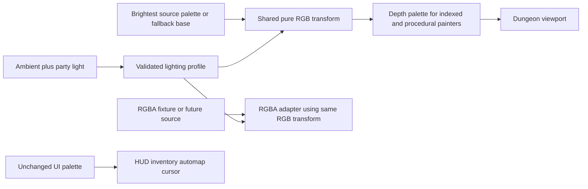

# Sprint — Parametric Dungeon Lighting (`sprint-2-lighting`)

Delivered locally after both planning gates, two implementation phases, independent QA, architecture/Tank approval and Smith actual-artifact approval. All LT-1…LT-5 accepted; seven retrospectives and local launch complete. Combat remains Sprint3. Root task.md remains the sole task board.

## 1. System Overview
Replace runtime selection of six historical shading ramps with one deterministic color transform. A lit corridor should become darker with less light and greater depth, while inventory, controls and carried cursor art remain legible. Preserve gameplay light production and burn rates. Authentic ramp colors are tuning references; exact historical shading is not an acceptance requirement (ADR-009).

Actual architecture: `paintDungeonViewport` computes clamped ambient + `partyLightBonus`, returns black at zero, and requests `getViewportLightPalette` at depths0–3. `Framebuffer.blitSprite` rejects transparent source indices before palette lookup. Existing wall/door masks use index10; item sprites use index0. World items, wall features, portraits and procedural surfaces consume the depth palette, with all procedural colors now explicitly using their derived depth palette (42 unreachable literal fallbacks removed). `getUiPalette` supplies the brightest source palette separately. `SpriteSource` currently returns indexed `DecodedSprite`; there is no runtime PNG/truecolor source loader.

### Accepted stories and evidence mapping
| ID | Story / acceptance | Required evidence |
|---|---|---|
| LT-1 | As a player, I see consistent dungeon lighting. For effective light0–5 and depth0–3, a single parametric transform replaces historical ramp selection. Zero light produces an entirely black viewport; brighter light cannot lower any neutral-profile channel; greater depth cannot increase it. Full light at near depth with neutral settings preserves source RGB. | Known RGB table, all24 light/depth combinations; integrated viewport dark/near/far scenes; proof changing lower historical ramps does not change output. |
| LT-2 | As an art author, indexed and truecolor source colors follow exactly the same transform. Preserve inputs and alpha; indexed transparency is decided before lookup/transform, including existing index10 wall keys and opaque black pixels. Truecolor support is a pure RGBA-data helper only in this sprint. | Equivalent indexed/RGBA fixture exact output, alpha0/partial/255 preservation, dense palette/parameter validation, clipping/flip/scaling/mask regressions. No claim of a PNG loader. |
| LT-3 | As a player, HUD, inventory, scroll/chest, automap, movement controls and carried cursor retain their existing colors across dungeon light changes. Lit world-item torch art stays complete and uses world lighting; its UI/cursor counterpart stays full brightness. Procedural dungeon geometry and RGB colors use the same transform at their assigned depth. | Pixel comparison outside viewport and of inventory/cursor; integrated direct-color fixture; original/fallback torch comparison and real browser screenshots. |
| LT-4 | As a developer, I can tune brightness curve, tint, distance falloff and desaturation from one validated local lighting profile without adding sprite variants. Repeated frames are deterministic; source ramps/assets and simulation state are not mutated. | Profile boundary/error tests, tint/desaturation known colors, repeat-render equality and immutability assertions; lint/types, bounded affected suites then aggregate/build once stable. |
| LT-5 | As a reviewer, I can see actual original and clean-room corridor results at zero/low/full light and multiple depths, plus unchanged UI. | Existing visual-review automation extended with named scenes and an error-free real Chromium run, Smith inspection of captures; source-absence explicitly recorded rather than substituted as original evidence. |

## 2. Architectural Principles
One pure RGB function owns the formula; palette mapping and RGBA mapping call it. Do not add a screen-wide overlay: that loses depth and risks darkening UI twice. Keep source colors immutable, transparency decisions in source space and black opaque unless explicitly masked. Retain the existing frame composition, painter order, occlusion and geometry.

No pack loader, automatic535 classification, source PNG consumption, new renderer backend, new dependency, services or deployment changes. Raw exporter index0 policy does not replace runtime index10 masks. No new lighting gameplay effects or emissive classification across assets.

## 3. Component Diagram

## 4. Class & Data Structures
Implemented `LightingProfile`: brightness exponent (finite positive), normalized tint RGB and tint strength0–1, depth multipliers for depths0–3 (finite0–1, nonincreasing), desaturation0–1. Store one locally imported `lighting.json` under render source with a documented schema; no fetch/config loader infrastructure. Validate once at boundary; invalid profiles fail clearly rather than silently producing NaNs. Pure helpers also reject invalid RGB/alpha shape or nonfinite light/depth inputs. Effective light is normalized from clamped0–5; depth domain remains0–3.

Implemented defaults: exponent1, neutral white tint/strength0, desaturation0, depth multipliers[1,1,0.8,0.6]. Formula: luma `0.2126*r + 0.7152*g + 0.0722*b`, lerp RGB toward luma by desaturation; multiply by tint blend, then `(effectiveLight/5)^exponent * depthMultiplier`; round once to byte range. Zero light is exactly black. Finite out-of-range effective light may clamp consistently with current caller; invalid depth is rejected. Use `Math.round` once after multiplication, then clamp0–255. Golden example with neutral settings: RGB[100,150,200], light2.5, depth2 yields[40,60,80]; full desaturation at full near light yields[143,143,143]. Reject nonfinite parameters, RGB outside integer0–255, malformed RGBA buffer length, exponent<=0, tint components/strength/desaturation outside0–1 and malformed/nonmonotonic depth multipliers.

`getViewportLightPalette` may remain a compatibility adapter, but derives every entry from `getUiPalette` (brightest source only) and the shared transform. It must never choose a dark historical ramp. RGBA helper preserves each alpha byte and transforms RGB through the same function; it does not blend or load images. All existing framebuffer masks/crops/flips stay intact.

## 5. Sequence & Interaction Flows
Frame computes existing effective light → zero-light black early return → create four derived palettes/context values → paint back-to-front at current depths → render HUD/overlays with unchanged UI palette. Explicitly audit every viewport hardcoded/direct RGB path, including `blitSideWallSprite` direct `setPixel`, fills, text, teleporters and doors: transform base colors once at the owning depth, avoiding double transformation of colors already drawn from derived palettes.

Fullbright policy is deliberately narrow: existing HUD/inventory/cursor/mirror-modal/automap paths bypass dungeon lighting; no world sprite is newly declared emissive. Sconce flame colors remain depth-lit like current behavior and complete torch icons remain depth-lit in world; zero-light early return wins. Future emissive artwork requires an explicit separate classification decision, not RGB/index heuristics.

### Delivered phases (Mouse owns actual tasks)
Phase1 — pure profile/transform plus indexed-palette and RGBA adapters: (1) implement meaningful known-data tests and validated pure helpers; (2) replace ramp adapter while preserving UI base palette. Neo → Trin independent QA → Morpheus review.

Phase2 — painter integration and visual acceptance: (1) route all direct procedural dungeon colors through the same depth context, preserve masks/torch/UI and cover integrated regressions; (2) extend existing visual review, run original/fallback scenes, document tuning and limits; (3) final acceptance audit LT1–5 and Smith actual screenshots, Oracle grooming/retrospective/local close. Neo → Trin → Morpheus → Smith. No new Make mechanism anticipated; any required target/script change receives Tank review first.

## 6. Technical Stack
Existing TypeScript, Canvas framebuffer, JSON module support, Vitest and pinned Playwright visual-review tooling. No dependency changes. All checks run through serial `bobp make` under root coordination. Planning runs no tests. Targeted meaningful checks precede a single aggregate/build after source stability; reuse unchanged evidence.

## 7. Refactoring Status & Technical Debt
The viewport color audit confirmed dense derived palettes cover direct RGB procedural paths; integration removed unreachable literal fallbacks and independently verified side-feature/item projection uses a single transform. No global postprocess or per-pixel callback overhead is required for indexed sprites; derive four small palettes per frame (cache only if needed and safe). Pure RGBA helper establishes color equivalence without pretending to ship runtime truecolor assets. Source six ramps stay decoded for UI brightest palette/reference; parser and exporter untouched. Runtime mask classification for535raw exports and semantic wall migration remain later work. Existing missing-jinja2 trace tooling is separate backlog, not a passed audit.

## 8. Final Accepted-Story Evidence — 2026-11-03

| Criterion | Actual evidence and result |
|---|---|
| LT-1 | PASS: independent literal24-cell light/depth RGB table, near identity, zero black, monotonicity/clamping and historical-dark-ramp independence; real original/fallback zero/low/full scenes at depths1–3. Pure tests cover depth0. |
| LT-2 | PASS: indexed/RGBA golden equivalence including tint/desaturation/exponent, alpha0/128/255 preservation, immutable source data and sparse/range validation. Source index0/index10 masking, opaque black and clipping/flip/scaling regressions remain covered. Pure RGBA helper only; no runtime image loader. |
| LT-3 | PASS: independent left/right side-projector markers prove depth-lit feature and item colors exactly once. Actual browser checks preserve inventory/cursor and outside-viewport UI except the changing LIGHT status text; complete world torch participates in lighting. Existing scroll/chest/automap/control regressions remain in the full aggregate. |
| LT-4 | PASS: validated local profile, known tuning formulas, repeat-frame equality and palette/RGBA/simulation-state immutability. Gameplay light production, torch burn, parser and raw exporter are unchanged. |
| LT-5 | PASS automated matrix: real Chromium26cases/98checks, both original535sprites and fallback available, browserErrors[] at19:17:04. PNGs and report live separately in ignored build/lighting-review; original-source absence is explicit partial failure. Root inspected representative actual PNGs; Smith explicitly approved actual-artifact usability at19:22:16. |

Final source-stable aggregate:250/250tests across37files plus ESLint/strict TypeScript passed19:18:17; sequential production build passed19:18:59 (121.34kB,41.66kB gzip). Two independent side-projector tests passed19:17:45 before that aggregate. No renderer source changed after the successful browser matrix. The old29interaction report under build/visual-review was not rerun or used as new lighting evidence.

Evidence: [Trin final independent QA](../agents/trin.docs/Lighting_Phase2_QA_Summary_2026-11-03T19-20.md), [Morpheus architecture approval](../agents/morpheus.docs/Lighting_Final_Review_Summary_2026-11-03T19-20.md), [Tank mechanism approval](../agents/tank.docs/Lighting_Mechanism_Final_Summary_2026-11-03T19-18.md), [SDLC](SDLC.md). No new dependency, target, CI, deployment or runtime truecolor loader. Missing-jinja2 trace audit remains unavailable, not passed. Root task.md and shared chat own final gate/close status.

Final UX approval: [Smith actual-artifact review](../agents/smith.docs/Lighting_Final_UX_Summary_2026-11-03T19-22.md).
