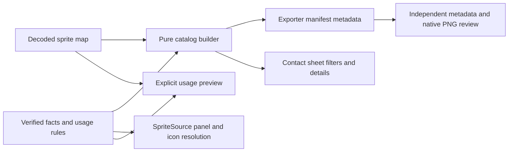

# Sprint — Verified Sprite Catalog and Usage Masks (`sprint-2-catalog`)

Delivered locally on 2026-11-06 after the Tier 2 Cypher/Morpheus plan, both Smith planning gates, Mouse board, Phase 1 and Phase 2 implementation, independent QA, architecture/mechanism review and Smith actual-artifact approval. Lighting changes remain uncommitted and intact. Root task.md remains the only task board. Combat remains Sprint 3.

## 1. System Overview
A maintainer opening SPRITES [G] should find any decoded sprite, understand what is actually known about it, and distinguish raw export transparency from the masks used in gameplay. Cover every decoded source index with metadata; do not pretend every image has been identified. This bounded sprint shares verified catalog knowledge between runtime semantic resolution, exporter and inspection tools before a future pack loader.

Actual findings from VIA: `createSpriteSource` repeats four panel keys also stored in exporter SEMANTIC_KEYS. It computes item atlas42–48 addressing separately. Exporter `category` has verified UI/range classifications; contact sheet has no catalog metadata and always checkerboards index0. `mountContactSheetUI` offers zoom/ramp controls and hover index/dimensions, click copies index. Raw atlas42–48 is not itself a standalone item: cropped item icons use index0 while full opaque artwork must not inherit that mask. Viewport wall/jamb/door uses index10, smashmask301 tests index0 separately. Same physical sprite may have multiple usages; usage policy is not one transparency property per index.

### Stories and acceptance-to-evidence mapping
| ID | Accepted-story proposal / measurable acceptance | Evidence |
|---|---|---|
| SC-1 | As a maintainer, I can inspect one stable metadata record per decoded index, with actual width/height, category, verified semantic keys, classification status and evidence references. The provided original archive has exactly535 unique records with no gaps relative to its decoded map; reduced synthetic maps remain supported. Unknown records explicitly say unclassified and have no invented label or runtime mask. | Set equality against parser indices, unique deterministic numeric ordering and measured dimensions; known/unknown fixtures; actual535 catalog audit. Complete metadata coverage is reported separately from verified-label count. |
| SC-2 | As an art author, I can see usage-specific policies: opaque source art, index0 cropped items/panels only where actually used, index10 wall/jamb/door masks, and a separate index0 smash-mask role. One atlas may expose several usages/crops. Existing runtime behavior, pixel data, lighting and raw index0 PNG export remain unchanged. | Independent fixtures for panel17, atlas42 item crop, wall85, door110 and smash301; source-call-site/evidence references; existing mask/render regressions and representative actual previews. No generic claim that all panels use index0. |
| SC-3 | As a developer, the four existing panel key→index mappings, verified categories/keys and item atlas addressing come from one pure shared catalog policy instead of duplicate classification tables. Export manifest and contact sheet agree with it; review still independently checks source dimensions, PNG palette/alpha/pixels and metadata integrity. | Table-driven independent expected mappings and item crop boundary tests; manifest/UI agreement, deterministic rerun and tamper regression; native535PNG fidelity review. Unknown keys keep existing fallback behavior. |
| SC-4 | As a maintainer, I open G, search by numeric index or verified key, filter category and known/unknown status, see shown/total and verified/unclassified counts, select a sprite and read dimensions, evidence and usage policies. Filters operate together, clear/reset works and no-match is explicit. Existing zoom, ramp-reference selection, click-copy index and Escape close still work. | Real-browser UAT: find17 by key and index; show unknown-only then known-only; category combination/no-match/reset; select42 and85, inspect policies; zoom/ramp, copy and Esc. Keyboard-labelled controls and selected details reachable without hover; no browser errors. |
| SC-5 | As a reviewer, I can compare a raw opaque preview, raw index0 export-style preview and a selected verified usage preview on checkerboard; headings explicitly identify the chosen interpretation. Unknown entries permit raw views but never advertise an inferred runtime policy. | Known pixel fixtures distinguish opaque black/index0/index10 holes; actual42 atlas vs cropped torch and85 wall captures, unknown raw preview; Smith inspects labels/readability and policy differences. |

## 2. Architectural Principles
Catalog facts are pure source metadata, not rendering heuristics. Separate measured record coverage from verified identity, raw-source index from derived icon crop, and usage from storage. Evidence-backed labels may be added for already verified floor75/ceiling76/walls/jambs/doors as feasible; the sprint does not require naming all535 images. Do not identify monsters or special art from dimensions or range guesses. No gameplay or broad painter migration.

Keep raw exporter policy `raw-index-0` and its ignored output ownership/strict palette562 contract (ADR011). Catalog usage metadata does not alter PNG alpha or brightness. Preserve ADR012 shared lighting and original/UI colors. Semantic fallback geometry stays recognizable where original art is not verified.

## 3. Component Diagram

## 4. Class & Data Structures
Proposed `SpriteCatalogEntry`: sourceIndex, measured width/height, category (existing ui/items/dungeon/unclassified), status verified/unclassified, semanticKeys[], evidence[], usages[]. Unknowns have empty verified labels/usages. `verified` means at least one reviewed identity/role, not complete understanding of the atlas. Document this definition beside UI counts.

Proposed usage record: stable usageKey, role, mask discriminant (`opaque`, `transparent-index` with0 or10, or `mask-index` with0), optional crop/address descriptor and evidence reference. Example atlas42 source inspection opaque, item.icon.4 crop16×16/index0; a door's bashed rendering may consult a separate sprite301 mask, not make301 a normal color sprite. Keep cross-sprite mask association explicit. Item-icon crop rules may be parameterized for224icons and7atlases; don't copy224unnecessary hardcoded entries. Derived icon IDs are not raw source IDs.

One runtime-neutral module under data owns verified fact tables, category lookup, panel resolution and icon address helper; catalog builder joins these with actual sprites and validates consistent keys/dimensions. Apply DM1 verified facts, categories, aliases and usage claims only when `bundle.source === AMIGA_GRAPHICS_DAT`. CLEAN_ROOM records with matching numeric indices/dimensions remain explicitly generated/unclassified with no DM1 identities or usages. A negative fixture for CLEAN_ROOM indices17/42 is required; original-source synthetic maps may exercise the explicit DM1 contract. Existing SpriteSource resolution/fallback behavior remains compatible; its legacy index helpers do not confer catalog provenance. It must not import UI/Node/Canvas. UI and exporter consume it; SpriteSource uses shared resolution while retaining cache/fallback behavior. Manifest schema1 fields, filenames/categories, four existing semantic aliases, PNG bytes and manifest bytes remain unchanged for the same source. Catalog-only status/evidence/usage fields stay in the separate inspection catalog; this sprint does not add manifest fields or new exported semantic aliases. Existing valid owned manifests must remain safely rerunnable; no path reshuffle or deletion of unowned files.

Independent review may consume the public catalog API for expected current metadata, but its PNG/chunk/source validation stays independent. Additional known-table and tamper tests prevent a shared mistaken classification from passing merely because both sides read the same wrong table.

## 5. Sequence & Interaction Flows
Load decoded map → build ordered catalog → filter entries without mutating source map → lay out only visible entries → select index → persistent detail panel and preview choice. An empty decoded map (clean-room data currently contains no raw sprites) displays a helpful empty-source state without implying535 records. The existing game remains usable when closing inspection; inspection shortcuts must not trigger gameplay while typing in filter controls. One Escape closes the inspector even from the search field, restoring focus; selected details are reachable through labelled keyboard controls as well as canvas clicks.

Default preview remains clearly labelled raw index0 to preserve current contact-sheet behavior. Selecting verified usage applies source mask/crop before palette lookup, exactly like the recorded runtime usage; opacity/index10 mode must not silently change exports. Ramp selector remains explicitly a source palette reference, separate from current parametric world lighting. Raw opaque and raw index0 are available even for unknown records. Keep actual source, current index and chosen interpretation visible. No browser writeback/classification editor or persistent user-edited manifest this sprint.

### Bounded phase proposal (Mouse writes actual tasks)
Phase1 — shared catalog foundation: (1) implement pure measured catalog + sparse evidence-backed facts/usage rules and independent known/unknown/crop tests; (2) consume shared policy in SpriteSource/exporter/review, preserving manifest filenames/raw pixels and fallback behavior, with strict-source/rerun/tamper regression evidence. Neo → Trin → Morpheus. Tank reviews any changed automation interface before execution.

Phase2 — observable inspection: (1) add contact-sheet filters/counts, persistent details and raw/verified-usage preview modes with labelled controls and empty states; (2) real-browser inspection UAT and representative PNGs, native all535 export verification and bounded aggregate/lint/build once stable; (3) final SC1–5 audit, Smith actual inspection, Oracle grooming/retrospective/local close. Neo → Trin → Morpheus → Tank mechanism review if scripts change → Smith. No implementation before planning gates.

## 6. Technical Stack
Existing TypeScript pure data helpers, Canvas contact-sheet renderer, DOM controls, Node exporter and pinned Playwright. No new dependency, service, runtime loader, environment variable or deployment. Existing Make targets preferred; coordinate Tank for runner changes. All Make calls serial under root ownership. Planning runs no tests; existing250pass baseline belongs to prior stable lighting source and is not re-executed for planning.

## 7. Refactoring Status & Technical Debt
Remove duplicate verified panel/category/address policy, not every hardcoded viewport sprite in this sprint. Runtime painters continue existing masks; catalog records and preview demonstrate that policy without an unsafe universal mask migration. Full535semantic identification, raw PNG runtime consumption, campaign packs, monster labeling/AI, combat and additional lighting features remain out. The future loader must consume usage metadata rather than treating a raw PNG as drop-in world/UI art. Preserve uncommitted lighting changes and no automatic commit/push.

## 8. Delivery Evidence — 2026-11-06

- Original catalog: `535` measured records, `39` verified roles and `496` explicitly unclassified; generated-source provenance guard passed.
- Actual browser inspector: `570` checks, `9` inspected captures and zero browser exceptions under `build/catalog-review/`.
- Independent inspection QA: `3/3` bounded tests passed after the browser gate.
- Final aggregate: ESLint, strict TypeScript and `268/268` tests across `41` files passed; production build transformed `40` modules.
- Compatibility: original source and manifest hashes and all `535` raw PNG bytes remained compatible; the previously completed independent native-PNG review was not repeated.
- Final gates: Trin QA, Morpheus architecture, Tank mechanism and Smith actual usability approval passed. The separate trace audit remains unavailable because its Python runner lacks `jinja2` and the Make recipe masks that error with exit 0; it is not claimed as a pass.
