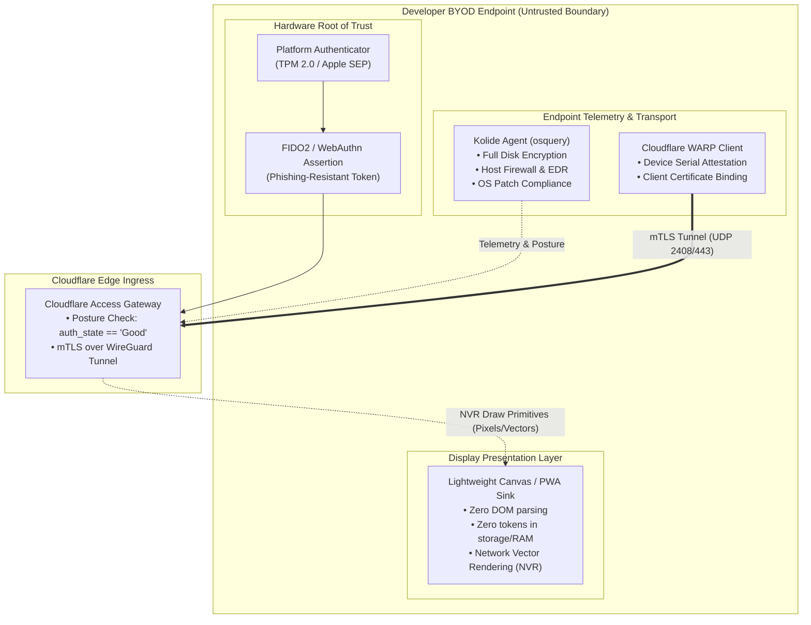
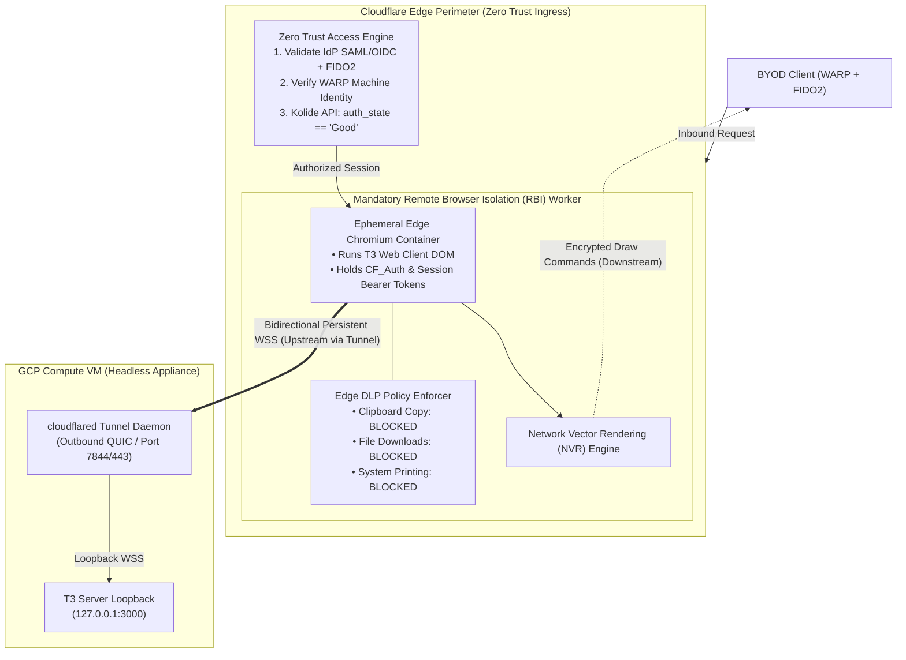
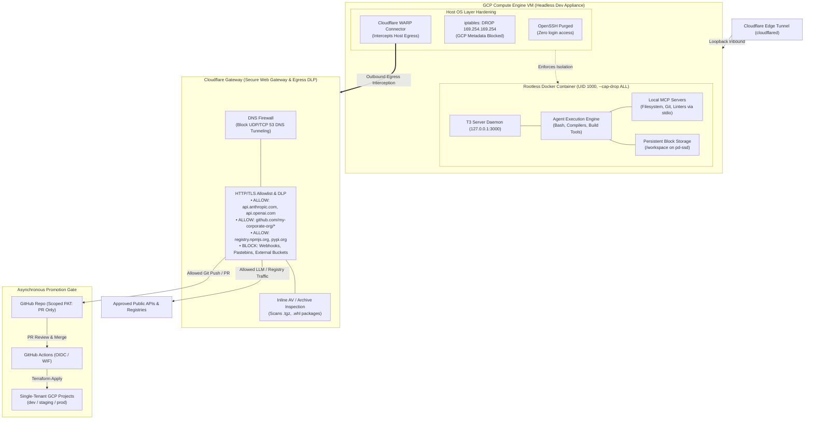

# **Page 1: Client BYOD Environment & Posture Controls**

### **Objective**

Treat the developer’s endpoint as an untrusted, potentially hostile execution environment. The client machine acts solely as a display terminal for vector render streams, with zero enterprise credentials, source code, or long-lived session tokens stored locally.

### **Professional System Architecture: Endpoint Attestation & Render Decoupling**

| Architecture Layer | Core Components & Security Functions |
| :---- | :---- |
| Hardware Root of Trust | • TPM 2.0 / Apple SEP• FIDO2 / WebAuthn Hardware Passkeys (Phishing-Resistant SSO)• Machine Identity Attestation |
| Endpoint Security Daemons | • Kolide Agent (Continuous osquery Posture Assessment)• Cloudflare WARP Client (Device Identity & Encrypted Transport) |
| Client Presentation Layer | • Lightweight Canvas / Vector Display Engine• Zero local DOM parsing, zero local storage, zero access tokens |
| Transport Boundary | ▼ Encrypted TLS 1.3 / mTLS \+ Signed Posture Payload ──► To Cloudflare Edge Ingress |

###

###

### **Core Security Controls**

#### **1\. Zero-Footprint Display Model**

> * **Zero Data at Rest:** The endpoint never runs the T3 Code web client DOM or JavaScript engine locally. No repository source files, diffs, terminal logs, or configuration secrets are written to endpoint storage (IndexedDB, LocalStorage, or browser cache).
> * **Infostealer Neutralization:** Because authentication cookies and bearer tokens exist exclusively in the edge-isolated browser, endpoint memory-scraping malware (e.g., via ptrace or MiniDumpWriteDump) cannot harvest session state.

#### **2\. Continuous Device Posture Verification (Kolide)**

> * **Pre-Handshake Hygiene Checks:** Before edge ingress is granted, the Kolide agent executes osquery checks to verify endpoint compliance:
  * Full disk encryption active (FileVault / BitLocker).
  * Host firewall enabled and OS security patches within the allowed N-1 release window.
  * Screen lock idle threshold enforced (≤ 5 minutes).
  * Endpoint Detection and Response (EDR) sensor running and uncompromised.
> * **Posture State Enforcement:** Device status must evaluate to auth\_state \== "Good". If a vulnerability is detected, Kolide flags the node, and the Cloudflare Edge revokes session authorization.

#### **3\. Cryptographic Identity & Transport (Cloudflare WARP)**

> * **Device-Bound mTLS:** The Cloudflare WARP client establishes an encrypted transport tunnel to the nearest edge PoP, injecting hardware-attested machine serial numbers and client certificates into every handshake.
> * **Network Cloaking:** The endpoint has no direct IP reachability to the backend development VM or VPC; all traffic routes through the brokered edge boundary.

#### **4\. Hardware-Backed Authentication**

> * **FIDO2 / WebAuthn Passkeys:** Primary authentication into the corporate IdP requires cryptographic proof of presence via a physical security key or platform biometric module (Touch ID / Windows Hello).
> * **Phishing & Replay Resistance:** Authentication challenges are bound to the specific edge FQDN, preventing credential harvesting via proxy domains.

#

#

# **Page 2: Cloudflare Network Access Control & Edge RBI Presentation**

### **Objective**

Provide an authenticated, identity-aware ingress barrier with zero exposed inbound ports. The edge terminates client transport, executes the application UI in a disposable sandbox, and streams only non-executable draw commands to the user.

### **Professional System Architecture: Edge Ingress, Brokering & Protocol Decoupling**

| Edge Stage | Processing & Security Controls |
| :---- | :---- |
| 1\. Ingress Handshake | Incoming request from Endpoint via Cloudflare WARP client |
| 2\. Zero Trust Access Gate | • Validate IdP SAML/OIDC Assertion \+ FIDO2 Token• Verify Cloudflare WARP Device Identity• Query Kolide API: Assert auth\_state \== "Good" |
| 3\. Remote Browser Isolation (RBI) | • Spawn ephemeral Chromium container at Cloudflare edge• Execute T3 web client DOM & terminate bidirectional WebSocket (WSS)• Retain session bearer tokens in edge volatile memory only• Enforce DLP: Block clipboard export, file downloads, and printing• Stream low-level draw commands via Network Vector Rendering (NVR) |
| 4\. Egress to Host VM | ▼ Encrypted Outbound QUIC/TLS Tunnel (cloudflared) ──► Host VM (Zero Open Inbound Ports) |

### **Core Security Controls**

#### **1\. Inbound-Free Perimeter (Cloudflare Tunnel)**

> * **Zero Public Attack Surface:** The backend VM runs cloudflared, which initiates redundant outbound-only connections to Cloudflare Edge PoPs over QUIC/TLS.
> * **Elimination of Scanning & Probing:** No public IP addresses, DNS A records pointing to cloud infrastructure, or open inbound firewall ports exist for attackers to scan or target with denial-of-service traffic.

#### **2\. Mandatory Edge Remote Browser Isolation (RBI)**

> * **Air-Gapped Client Runtime:** The T3 client web application loads within an ephemeral, disposable container at the Cloudflare edge.
> * **Network Vector Rendering (NVR):** The edge converts the rendered page into an encrypted stream of low-level 2D draw commands sent to the client canvas. The client never parses raw HTML, CSS, or external JavaScript.
> * **CSWSH Immunity:** Cross-Site WebSocket Hijacking is impossible from adjacent tabs on the developer’s local browser, as the local network cannot access or address the isolated edge session.

#### **3\. Edge Data Loss Prevention (DLP)**

> * **Clipboard Boundaries:** Bidirectional clipboard controls allow pasting text into the T3 session but block copying text or code back to the BYOD clipboard.
> * **File Transfer Blocking:** Local file downloads and system print invocations triggered from within the T3 web UI are intercepted and dropped at the edge layer.

#### **4\. Session & WebSocket Lifecycle Management**

> * **Deterministic Session Expiration:** Access policies enforce a strict re-authentication interval (e.g., 2 to 4 hours), requiring an updated posture evaluation and FIDO2 touch.
> * **Persistent WebSocket Resilience:** The edge proxy manages the bidirectional WebSocket channel natively, preventing connection drops during long-running agent tool-use execution loops.

# **Page 3: T3 Dev Environment, Agent & MCP Runtime, and Gateway Egress DLP**

### **Objective**

Provide a functional, high-velocity development host for autonomous agent loops, build toolchains, and Model Context Protocol (MCP) integrations, while routing all outbound traffic through Cloudflare Gateway to prevent data exfiltration, block malicious assets, and isolate cloud infrastructure.

### **Professional System Architecture: Execution Sandboxing, Egress DLP & Promotion**

| System Boundary | Runtime Environment & DLP Controls |
| :---- | :---- |
| 1\. Edge Ingress | Outbound-initiated cloudflared tunnel connection from Cloudflare Edge |
| 2\. Headless VM Host | • Headless Linux OS (OpenSSH purged, zero interactive login)• Cloudflare WARP Connector routing outbound host traffic• Host iptables rule dropping GCP Metadata API (169.254.169.254) |
| 3\. Isolated Dev Container | • T3 Server Daemon listening on 127.0.0.1:3000• Autonomous agent execution engine & build toolchains• Model Context Protocol (MCP) servers (filesystem, git, linters)• Persistent workspace volume (/workspace on pd-ssd) |
| 4\. Cloudflare Gateway (Egress DLP) | • DNS filtering: Block UDP/TCP 53 to prevent DNS tunneling• HTTP/TLS allowlisting: LLM APIs, corporate GitHub repos, package registries• DLP enforcement: Block unapproved webhooks, pastebins, and external buckets• Inline AV scanning on package archives (.tgz, .whl) |

###

### **Core Security Controls**

#### **1\. Dev Runtime, Agent & MCP Hosting**

> * **Headless Developer Appliance:** Developers never log into the VM directly via SSH or RDP. The host operates as a headless backend whose sole interface is the T3 control plane bridged over cloudflared.
> * **Agent & Tool Execution:** The T3 server, toolchain binaries (Node.js, Rust, Python, Go), and compilers run within a dedicated containerized workspace mounted to high-speed persistent block storage (pd-ssd), ensuring build caches and language servers persist across runs.
> * **Model Context Protocol (MCP) Support:** Local MCP servers run as child processes under the agent (communicating over stdio), while approved remote MCP servers communicate externally through the Gateway-inspected network boundary.
> * **Least-Privilege Containerization:** The execution container runs as an unprivileged user (UID 1000\) with \--security-opt no-new-privileges and drops administrative capabilities, ensuring an agentic shell breakout cannot compromise the underlying host OS.

#### **2\. Cloudflare Gateway Egress DLP & Asset Filtering**

> * **Default-Deny Outbound Model:** All host egress is intercepted by the Cloudflare WARP Connector and evaluated against Cloudflare Gateway rules. The VM cannot open arbitrary outbound network connections.
> * **Allowlist for Known-Good Destinations:** Outbound HTTP/HTTPS traffic is restricted exclusively to vetted enterprise endpoints:
  * **LLM Provider APIs:** Anthropic, OpenAI, or corporate model gateways.
  * **Authorized SCM:** GitHub endpoints restricted to the corporate organization namespace.
  * **Verified Package Repositories:** Designated package registries (registry.npmjs.org, pypi.org, crates.io) or private artifact mirrors.
  * **Vetted MCP Connectors:** Explicitly whitelisted third-party tool APIs.
> * **Exfiltration Vector Suppression:** Gateway blocks direct HTTP POST payloads to unapproved webhooks (e.g., Discord, Slack, Webhook.site), unmanaged cloud object stores (S3, GCS buckets), pastebins, and personal Git remotes.
> * **DNS Tunneling Mitigation:** Host egress to raw public DNS servers (8.8.8.8, 1.1.1.1) is blocked at the firewall. All name resolution must traverse Cloudflare Gateway, which inspects queries for high-entropy domain generation and DNS tunneling patterns.
> * **Payload Antivirus & Content Inspection:** Gateway performs inline inspection on downloaded packages, tarballs, and wheels, blocking known malicious binaries and trojanized dependencies before they reach the workspace.

#### **3\. GCP Isolation & Promotion Gate**

> * **Instance Metadata Blackhole:** A host-level firewall rule drops all egress to 169.254.169.254. Even if an agent or rogue dependency attempts to scrape cloud credentials, the metadata server is completely unreachable:
>     sudo iptables \-A OUTPUT \-d 169.254.169.254 \-j DROP
> * **Zero GCP IAM Authority:** The VM's assigned service account carries no IAM roles within the GCP organization, permanently severing the dev appliance from production and staging environments.
> * **Asynchronous CI/CD Promotion:** The agent possesses only a fine-grained GitHub token scoped to branch writes and Pull Requests. Direct mutation of single-tenant GCP environments is strictly impossible from the VM; all deployments execute asynchronously via GitHub Actions using Workload Identity Federation (WIF) and Terraform after human review.
